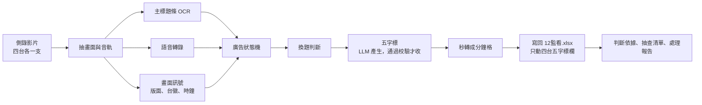
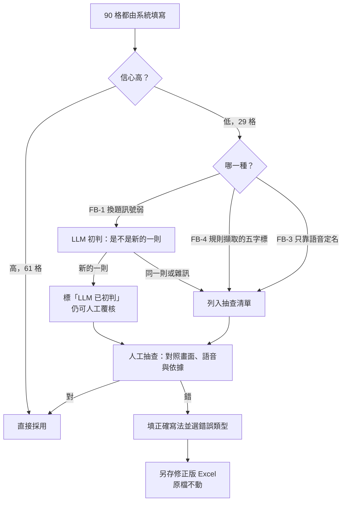

# NewsBar Copilot

三立新聞每天要有人盯著四個競台的畫面，每分鐘記一格「這分鐘在播哪則新聞」，寫成五個字左右的標題，填進「12監看」Excel。這個專案把這件事交給電腦做：給它側錄影片和空白的範本，它讀畫面下方的新聞標題條、判斷什麼時候換題、什麼時候是廣告，產生五字標，寫回 Excel。

這是 UNEXT AI 企業創新實戰營 S36 的提案作品。程式全部在本機跑，影片和表格不會送到外部服務。

## 現在做到哪裡

用 2026/11/06 12:00–13:00 的民視、TVBS、東森、華視四台側錄實跑過一次，共 90 格。

| 項目 | 目標 | 實測 |
|---|---|---|
| 換題時間點 F1（容許 ±1 分鐘，TVBS 對照研究者初標） | 0.85 以上 | 0.885，未調參的後 40 分鐘為 0.867 |
| 廣告分鐘 F1 | 0.90 以上 | 0.95 |
| 自動填寫率 | 100% | 100% |
| 四台一小時的處理時間（Mac M4） | 15 分鐘以內 | 46 分鐘 |

幾件要先講清楚的事：

- **標準答案還不是正式的。** 目前只有 TVBS 一台、約 30 個點，由研究者一個人初標，不是雙人標註，所以 F1 只能當參考。
- **處理時間沒達標。** 語音轉錄一次只能跑一台，這台電腦沒有 NVIDIA GPU。換成有 GPU 的機器才有可能達到 15 分鐘，這點還沒實測。
- **90 格裡有 29 格是低信心。** 其中 14 格是換題訊號偏弱（FB-1），15 格的五字標是 LLM 兩次沒通過校驗、改用規則從標題擷取的（FB-4），1 格是 OCR 讀不到、靠語音定名（FB-3）。這些格子照常填，另外列進抽查清單，要人來看。
- **TVBS 12:24 有一段廣告判錯**，其他台的廣告頭尾也有約 10 秒的誤差。等正式標註出來再調規則。

## 怎麼用

需要 macOS（用 Apple Vision 做 OCR）、Python 3.11、FFmpeg、[Ollama](https://ollama.com)。

```bash
uv sync --python 3.11 --extra mac
ollama pull qwen2.5:7b-instruct
uv run pytest        # 沒有影片也能跑，測試用程式合成的新聞畫面
```

四台側錄影片版權屬各電視台，由課程提供，不放在這個 repo。拿到後放到 `data/raw/{tvbs,ettv,ftv,cts}.ts`，範本放 `data/raw/template.xlsx`。

### 網頁後台（給監看員）

```bash
uv run newsbar serve --channels config/channels.1106.yaml --rules config/rules.1106.yaml \
  --rules-fast config/rules.1106.fast.yaml --workdir data/work_full
```

打開 http://127.0.0.1:8765，只綁本機。流程是：選四台影片、開始分析、看各台進度、看結果、下載 Excel。

結果頁每一段新聞都能點開，看到當下完整畫面、主標題條的裁切圖、OCR 讀到的字、語音辨識結果和判斷依據。畫面或標籤不對，可以直接在頁面上標「對」或填正確寫法、選錯誤類型，再產生「修正版」Excel。原本的 Excel 不會被改動。

結果頁上的「LLM 初判換題」按鈕，會請本機模型看每個 FB-1 的標題是不是新的一則新聞。判成「新的一則」的格子在清單上標「LLM 已初判」，其他仍列入抽查。這只是參考意見，不會寫進表格。

### 命令列

```bash
# 四台影片 → 監看表、判斷依據、處理報告、抽查頁（畫面時鐘會自動讀取校時）
uv run newsbar run --template data/raw/template.xlsx --out out/12監看_20261106.xlsx \
  --video tvbs=data/raw/tvbs.ts --video ettv=data/raw/ettv.ts \
  --video ftv=data/raw/ftv.ts --video cts=data/raw/cts.ts \
  --channels config/channels.1106.yaml --rules config/rules.1106.yaml \
  --workdir data/work_full --jobs 4 --resume

# 跟標準答案比對
uv run newsbar eval --system out/12監看_20261106.xlsx --gold gold.xlsx --test-from 1220

# 抽查後另存修正版
uv run newsbar apply-corrections --sheet out/12監看_20261106.xlsx --corrections corrections.json \
  --template data/raw/template.xlsx --out out/12監看_20261106.修正版.xlsx
```

`--resume` 會沿用已經跑過的 OCR 與語音結果，只重跑換題和五字標。同一支影片重跑，五字標會逐格相同：模型溫度固定為 0，答案也存在快取裡。改了提示詞要更新 `llm.py` 的 `PROMPT_VERSION`，快取才不會把舊答案又拿出來用。

產出檔案：`*.xlsx`（監看表）、`*.evidence.jsonl`（每格的依據）、`*.report.csv`（抽查清單，低信心排最前面）、`*.report.json`（處理報告）、`*.review.html`（抽查頁）。

## 判斷怎麼做



- **先判廣告，再判換題。** 廣告包框裡殘留的標題條文字不採用。廣告靠版面、底色、台徽、黑場靜音、廣告語音、聲音指紋、跑馬列消失、畫面時鐘消失等訊號，通常要兩個以上同時成立。
- **換題看標題條。** 標題穩定出現 7 秒才算一則新聞，廣告前不到 20 秒的片段併進廣告，3 分鐘內同一則標題輪回併回原本那一則。
- **五字標由 LLM 產生，但要過校驗。** 字數 4 到 6，字必須出現在畫面標題裡，社會新聞要有地點。兩次都沒過，就改用規則從標題擷取「地點＋核心動詞」。
- **每一格都由系統決定，不停下來等人。** 沒把握的標成低信心，交給人抽查。
- **只動四個競台的五字標欄**，範本其他欄位與格式在寫入前後都會比對，不能有變動。

LLM 用的是本機 Ollama 的 `qwen2.5:7b-instruct`。地端 7B 模型常寫出超過六個字或用了標題以外的字，所以才需要校驗和規則備援。提示詞已加上字數規則，在 17 個 FB-4 格上測，字數錯誤從約一半降到 1 個，但還沒用新提示詞重跑 11/06 的 Excel，現有成品仍是舊提示詞的結果。

### 低信心的格子怎麼處理



### 還沒解決的

- FB-4 的五字標：用同一個本機模型當裁判，它幾乎每個標籤都說要修，還放過截斷的「高雄老店歇」，目前不可靠，所以後台只接了 FB-1 的初判。想省這部分的人工，需要更強的模型（要送標題到外部 API，要先決定能不能送）。
- 「廣告結束後接回同一則新聞，要留白還是重記標」要請業師確認。要問業師的完整清單在 [docs/mentor-questions.md](docs/mentor-questions.md)。

## 文件

- [docs/requirements.md](docs/requirements.md)：需求分析與逐條狀態
- [docs/spec.md](docs/spec.md)：痛點、規則、測試案例
- [docs/architecture.md](docs/architecture.md)：系統架構與實作狀態

## 線上展示

- 監看台（四台逐格判斷依據、截圖、廣告時間軸、TVBS 對照）：https://claude.ai/artifact/8P4J7qDJsnfJyGeUFKCcJ2
- 操作原型（同一流程的靜態展示，沒有串接後端）：https://claude.ai/artifact/RL2VhX96ci22nN5znaiBSK
