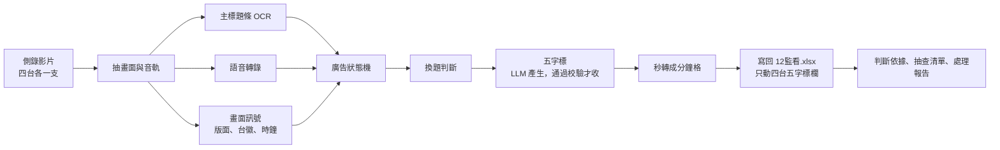
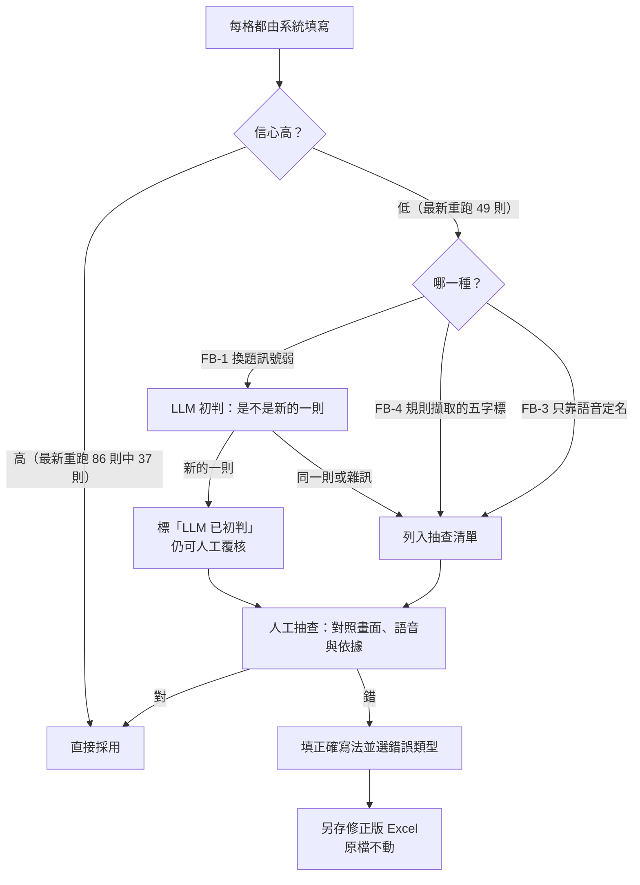

# NewsBar Copilot

三立新聞每天要有人盯著四個競台的畫面，每分鐘記一格「這分鐘在播哪則新聞」，寫成五個字左右的標題，填進「12監看」Excel。這個專案把這件事交給電腦做：給它側錄影片和空白的範本，它讀畫面下方的新聞標題條、判斷什麼時候換題、什麼時候是廣告，產生五字標，寫回 Excel。

這是 UNEXT AI 企業創新實戰營 S36 的提案作品。影片、聲音和表格都在本機處理，不會送到外部服務。五字標預設先交給雲端模型寫（NVIDIA 託管的 `nvidia/nemotron-3.5-super-vl-120b-a12b`），只送主標題文字；有疑難時才另送一張主標題列裁切圖。金鑰放環境變數 `NVIDIA_API_KEY`。沒有金鑰或沒有網路時，自動改用本機 Ollama 的 `qwen2.5:7b-instruct`，流程照常跑完。只想用本機，把規則檔的 `labeler.generator` 改成 `ollama`。

## 現在做到哪裡

用 2026/11/06 12:00–13:00 的民視、TVBS、東森、華視四台側錄實跑過一次。最新重跑（11/22 下午，沿用同一份擷取結果、只重跑換題與五字標）輸出在 `out/check_1122`，共 98 格。以下數字都來自規則加本機 LLM（qwen2.5:7b），RAG 與 ML 為選配、預設關閉。

| 項目 | 目標 | 實測 |
|---|---|---|
| 換題時間點 F1（容許 ±1 分鐘，TVBS 對照研究者初標） | 0.85 以上 | 全小時 0.923（precision 0.96、recall 0.889） |
| 換題時間點 F1（秒級，容許 ±30 秒） | — | 0.857；對上的換題點時間差中位數 0 秒；切太碎 5、漏切 3 |
| 廣告 F1 | 0.90 以上 | 0.952（標準答案改用和系統相同的分鐘寫法後；廣告誤入新聞 17 秒） |
| 自動填寫率 | 100% | 100%（設計保證：每格都會填值，不是準確率） |
| 四台一小時的處理時間（Mac M4，fast 模式） | 15 分鐘以內 | 46 分鐘，未達標 |

幾件要先講清楚的事：

- **標準答案還不是正式的。** 目前只有 TVBS 一台、27 個換題點與 10 段廣告，由研究者一個人初標，不是雙人標註，所以 F1 只能當參考。另外三台沒有標準答案：11/22 修掉的「不同新聞被併成一則」（民視巴拉圭總統→幼兒園過馬路→涼圓店）就是在這三台上人工看出來的，量不到分數。
- **不是獨立驗證集。** 規則都在 11/06 這一小時上調過，這些數字不能當作未見過資料的成績。
- **處理時間沒達標。** 語音轉錄一次只能跑一台，這台電腦沒有 NVIDIA GPU。46 分鐘裡擷取佔 43.5 分、決策佔 2.7 分。換成有 GPU 的機器才有可能達到 15 分鐘，GPU 平行版還沒實測。不開語音（關掉 ASR）時，換題全小時 F1 降到 0.758。
- **98 格裡有 63 格標成「需複查」，35 格自動通過。** 理由：26 格是 AI 三次都沒通過檢查、改用規則從標題擷取（FB-4；其中 3 格標題裡找不到頭尾都不切詞的 5 個字，仍切到詞），11 格是換題只有「標題變了」一項證據（FB-1），1 格讀不到標題、靠語音定名（FB-3），其餘是「社會新聞但標題沒有地點」或「未確認語氣」的提醒。交付檢查的結果是「可交付，含待複查項目」。這些格子照常填，列在複查清單，要人來看。
- **TVBS 12:24 有一段廣告判錯**，其他台的廣告頭尾也有約 10 秒的誤差。等正式標註出來再調規則。

## 怎麼用

需要 macOS（用 Apple Vision 做 OCR）、Python 3.11、FFmpeg、[Ollama](https://ollama.com)。

```bash
uv sync --python 3.11 --extra mac
ollama pull qwen2.5:7b-instruct
uv run pytest        # 沒有影片也能跑，測試用程式合成的新聞畫面
```

四台側錄影片版權屬各電視台，由課程提供，不放在這個 repo。拿到後放到 `data/raw/{tvbs,ettv,ftv,cts}.ts`，範本放 `data/raw/template.xlsx`。

### 網頁後台（給監看員）

```bash
uv run newsbar serve --channels config/channels.1106.yaml --rules config/rules.1106.yaml \
  --rules-fast config/rules.1106.fast.yaml --workdir data/work_full
```

打開 http://127.0.0.1:8765，只綁本機。流程是：選四台影片、開始分析、看各台進度、看結果、下載 Excel。

結果頁每一段新聞都能點開，看到當下完整畫面、主標題條的裁切圖、OCR 讀到的字、語音辨識結果和判斷依據。畫面或標籤不對，可以直接在頁面上標「對」或填正確寫法、選錯誤類型，再產生「修正版」Excel。原本的 Excel 不會被改動。

結果頁上的「LLM 初判換題」按鈕，會請本機模型看每個 FB-1 的標題是不是新的一則新聞。判成「新的一則」的格子在清單上標「LLM 已初判」，其他仍列入抽查。這只是參考意見，不會寫進表格。

### 命令列

```bash
# 四台影片 → 監看表、判斷依據、處理報告、抽查頁（畫面時鐘會自動讀取校時）
uv run newsbar run --template data/raw/template.xlsx --out out/12監看_20261106.xlsx \
  --video tvbs=data/raw/tvbs.ts --video ettv=data/raw/ettv.ts \
  --video ftv=data/raw/ftv.ts --video cts=data/raw/cts.ts \
  --channels config/channels.1106.yaml --rules config/rules.1106.yaml \
  --workdir data/work_full --jobs 4 --resume

# 跟標準答案比對
uv run newsbar gold-import --annotation eval/gold/tvbs_researcher_provisional.json --template data/raw/template.xlsx \
  --out gold.xlsx --channels config/channels.1106.yaml --rules config/rules.1106.yaml
uv run newsbar eval --system out/12監看_20261106.xlsx --gold gold.xlsx --channels config/channels.1106.yaml \
  --stories out/12監看_20261106.stories.jsonl --annotation eval/gold/tvbs_researcher_provisional.json

# 抽查後另存修正版
uv run newsbar apply-corrections --sheet out/12監看_20261106.xlsx --corrections corrections.json \
  --template data/raw/template.xlsx --out out/12監看_20261106.修正版.xlsx
```

`--resume` 會沿用已經跑過的 OCR 與語音結果，只重跑換題和五字標。同一支影片重跑，五字標會逐格相同：模型溫度固定為 0，答案也存在快取裡。改了提示詞要更新 `llm.py` 的 `PROMPT_VERSION`，快取才不會把舊答案又拿出來用。

產出檔案：`*.xlsx`（監看表）、`*.evidence.jsonl`（每格的依據與品質狀態）、`*.stories.jsonl`（每個換題點的理由代碼、證據與是否需複查，一則一行）、`*.report.csv`（複查清單，需複查的排最前面）、`*.report.json`（處理報告，含每台執行狀態與交付檢查）、`*.manifest.json`（這次執行的版本紀錄：程式版本、設定、影片指紋、模型）、`*.review.html`（複查頁）。

跑完之後的複查：開 `*.review.html`，只看標成「需複查」的格子，對照標題截圖，每格選「對／錯，改成…／不可用」並匯出 `corrections.json`，再用 `newsbar apply-corrections` 另存修正版 Excel 與修正版依據檔（每格記下 HUMAN_APPROVED／REJECTED、修正值、複查人與時間；原始結果不會被覆寫）。

`--resume` 只在影片、該台擷取設定、OCR／語音後端都和上次相同時才沿用擷取結果，否則該台重新擷取並說明原因；舊版沒有版本紀錄的擷取結果照樣沿用，但會警告。

## 兩種版本：Mac 與 NVIDIA GPU

同一份程式碼，靠設定檔與安裝組切換，不用分支。

| | Mac 版（11/06 實測用） | NVIDIA GPU 版（程式已備，尚未實測） |
|---|---|---|
| 適用機器 | macOS，Apple 晶片 | Linux，NVIDIA 顯示卡（CUDA） |
| 文字辨識 | Apple Vision | PaddleOCR 2.x，自動用顯示卡 |
| 語音轉錄 | faster-whisper `small`，Apple GPU | faster-whisper `large-v3-turbo`，CUDA float16 |
| 同時轉錄幾台 | 1 台（Apple GPU 共用會互相拖慢） | 8 GB 顯示卡 2 台，16 GB 以上可設 4 台 |
| 設定檔 | `config/rules.1106.yaml` | `config/rules.gpu.yaml` |
| 安裝 | `uv sync --extra mac --extra asr` | `uv sync --extra gpu` |

GPU 版：

```bash
uv sync --python 3.11 --extra gpu      # paddlepaddle-gpu 要對上 CUDA 版本；PyPI 的版本不合時，改用 Paddle 官方安裝指令
ollama pull qwen2.5:7b-instruct
OLLAMA_NUM_PARALLEL=4 ollama serve      # 讓 AI 寫標可以同時處理四個請求
uv run newsbar run --backend paddle --asr faster-whisper --rules config/rules.gpu.yaml \
  --channels config/channels.1106.yaml --template data/raw/template.xlsx --out out/12監看.xlsx \
  --video tvbs=data/raw/tvbs.ts --video ettv=data/raw/ettv.ts --video ftv=data/raw/ftv.ts --video cts=data/raw/cts.ts --jobs 4
```

- 同時轉錄台數：`--asr-parallel N` 或設定檔的 `asr.parallel`。沒設定時 Mac 是 1、其他機器是 2。
- 強制指定裝置：`NEWSBAR_ASR_DEVICE`（auto、cuda、mps、cpu）、`NEWSBAR_ASR_COMPUTE`（float16、int8 等）、`NEWSBAR_OCR_GPU`（1 或 0）。
- GPU 版還沒在 NVIDIA 機器上跑過。四台一小時能否壓到 15 分鐘，要實測後才知道。

## 判斷規則

每一條判斷規則（讀哪裡的字、怎麼認廣告、怎麼換題、秒怎麼對到分鐘、五字標的檢查、不確定時怎麼辦）都用白話中文列在 [docs/rules.md](docs/rules.md)，依三立的痛點分成七組，每條附程式位置和目前的數字。規則的唯一來源是 `src/newsbar/rulebook.py`，測試會核對文件上的數字等於程式實際用的預設值；程式裡每個判斷處也有「# 規則 編號」註解可以搜尋。

```bash
uv run newsbar rules                          # 在終端機印出全部規則
uv run newsbar rules --markdown docs/rules.md # 重新產生文件
uv run newsbar rules --json rules.json        # 給其他工具讀
```

## 判斷怎麼做



- **先判廣告，再判換題。** 廣告包框裡殘留的標題條文字不採用。廣告靠版面、底色、台徽、黑場靜音、廣告語音、聲音指紋、跑馬列消失、畫面時鐘消失等訊號，通常要兩個以上同時成立。
- **換題看標題條。** 標題穩定出現 7 秒才算一則新聞，廣告前不到 20 秒的片段併進廣告，3 分鐘內同一則標題輪回併回原本那一則。
- **五字標由 AI 產生，但要過校驗。** 剛好 5 個字，字必須出現在畫面標題裡，不能切斷詞，未確認的事不能寫成定論。寫的順序：
  1. 雲端模型寫，沒過就帶原因重寫，最多 2 次。
  2. 雲端沒回應，改由本機模型寫。
  3. 都沒過檢查，就列出已通過檢查的候選，請 AI 挑一個。
  4. 還是不行，就把主標題列截圖送給雲端模型看圖重寫。
  5. 全部都失敗，才用規則從標題擷取，並標「建議回查」。
- **每一格都由系統決定，不停下來等人。** 沒把握的標成低信心，交給人抽查。
- **只動四個競台的五字標欄**，範本其他欄位與格式在寫入前後都會比對，不能有變動。

11/06 一小時實測（11/23，沿用 11/22 的擷取結果；TVBS 單人標註）：換題 F1 0.963，廣告 0.952。雲端→本機版的 105 則五字標全部剛好 5 字，只剩 3 則是規則擷取；只用本機版則有 21 則。雲端答案每次可能不同，所以每個答案都存在工作資料夾的快取檔，重跑時沿用。還沒拿到雲端答案的格子，重跑時會再問一次，結果可能不同。

### 低信心的格子怎麼處理



### 還沒解決的

- FB-4 的五字標：用同一個本機模型當裁判，它幾乎每個標籤都說要修，還放過截斷的「高雄老店歇」，目前不可靠，所以後台只接了 FB-1 的初判。想省這部分的人工，需要更強的模型（要送標題到外部 API，要先決定能不能送）。
- 「廣告結束後接回同一則新聞，要留白還是重記標」待業師確認。

## 擴充到其他時段與頻道

**換時段（例如晚上 6 點、下午 4 點）。** 不用改程式：

```bash
uv run newsbar run --input-dir data/raw --sheet-start 1800 --minutes 60 \
  --channels config/channels.1106.yaml --rules config/rules.1106.yaml --jobs 4
```

- `--sheet-start HHMM` 是表格第一列的分鐘，`--minutes` 是要填幾列（預設 60）。每台影片第 0 秒對到哪一分鐘，由畫面時鐘決定；讀不到就改用檔名裡的時間（例：`tvbs_20261106_1800.ts`），再不行才假設等於 `--sheet-start`，這幾種情況該台每格都會標「待複查」。
- 範本的時間列和台別表頭由程式用「時間」「五字標」字樣定位，所以晚間版面只要同樣有這兩個表頭就能用。
- 每小時一組的自動處理用 `newsbar watch`。

**加一個頻道。**

1. 在 `config/channels.*.yaml` 的 `channels:` 下新增一段（參考 `channels.example.yaml`）：`name`、`excel_column_header`（要和 Excel 台別表頭一字不差）、`main_bar`、`ticker`、`clock`、`logo`、`main_video` 等 ROI（0–1 的比例，x,y,w,h）。
2. 座標要看畫面校正：`newsbar calibrate --video 影片 --channel 新台別 --channels 設定檔 --at 30` 會輸出整張畫面和校正頁（`src/newsbar/calibrate_ui.py` 產生的 `roi.html`）。在頁面上拖出各區域，複製產生的 yaml 貼回設定檔，再跑一次確認每個區域 OCR 讀到的字對不對。
3. 檔名要含台別代號或名稱，`--input-dir` 才找得到影片。
4. 各台版面不同，ROI 一定要逐台、逐版面人工看過；換版面要重校。`rules.1106.yaml` 的門檻是用 11/06 午間調的，換時段先用少量標準答案重新評估。

**改地名、關鍵字、畫面疊字。** 全部在 `config/lexicon.yaml`，改完下次 run 就生效（`--lexicon` 可指定別份）：

- `districts`、`counties`、`landmarks`、`place_stopwords`：地名（22 縣市與全部鄉鎮市區）。社會新聞的五字標一定要帶來源裡的地點；來源沒有地點的格子標「社會新聞無地點」。
- `social_keywords`、`weather_words`：判斷社會新聞、氣象的字。
- `hedge_markers`、`hedge_exclusions`：疑似、傳出、恐、涉嫌這類未確認語氣。來源有而五字標拿掉，就不收；備援標籤也拿不回來時標「未確認語氣」。
- `overlay_tokens`、`overlay_patterns`：主標題條裡單獨出現的 LIVE、直播、獨家、最新、角落溫度，換題判斷前先刪掉。
- 檔案裡只要列了某個鍵，就整組取代內建預設；沒列的鍵用內建值（`src/newsbar/lexicon_default.yaml`）。

**沒有 Ollama 或模型當掉時**，`run` 會先檢查服務、必要時啟動 `ollama serve`；仍連不上就整批改用規則擷取五字標並標為低信心，不會停。單一台處理失敗時，其他台照常出表，失敗的台列在複查清單（`.report.csv` 第一列、`.review.html` 上方、`.report.json` 的 `failed_channels`），Excel 裡不會有任何標記。`run` 另存一份 `*_複查版.xlsx`：異常格標黃並附註解（影片時間、OCR、語音、原因），交件用沒有標記的那份；不要複查版加 `--no-review-copy`。

## RAG 與 ML（預設關閉）

兩項功能都預設關閉，不開時輸出與提示詞和原本逐位元相同（`labeler.rag.enabled: false`、`segmenter.mode: rules`、`ad_state.mode: rules`）。設計成回饋迴圈：三立每多給一批標好的資料，重建 KB、重訓模型，再用同一個留出窗比較。

**RAG：五字標檢索**（`src/newsbar/kb.py`）

```bash
newsbar kb build --workdir data/work_full --out-root out/web   # gold + 抽查修正 + FEW_SHOT 種子 → data/kb/labels.jsonl
newsbar kb add-sheet --sheet 舊表.xlsx --titles 標題.csv --date 2026-10-26   # 歷史監看表
newsbar kb eval --rules config/rules.1106.yaml --workdir data/work_full      # 逐題排除自己，RAG 關/開對照
newsbar run ... --kb data/kb/labels.jsonl                       # 給了 --kb 就啟用；或在 rules 設 labeler.rag.enabled: true
```

- 一筆 = `{id, title, label, channel, date, source: gold|correction|history|seed}`。只收「五字標通過 `labeler.validate`（對它自己的標題）」的配對，所以範例不會教模型違反規則。
- **只有五字標的舊監看表配不成對**：表上沒有標題，必須另附標題檔（csv/json/jsonl：`channel,minute,title`，或 `newsbar run` 產生的 `*.evidence.jsonl`）。
- 檢索用字元二連詞 TF-IDF 餘弦（numpy，不需額外套件、不需嵌入模型），取前 `k` 筆（預設 3），插在 FEW_SHOT 後面當額外對話輪。啟用時 `PROMPT_VERSION` 為 `v4-rag`，快取鍵含取回的 id 與五字標；關閉時仍是 `v3-hedge`，舊快取照用。
- 回饋：監看員在網頁存抽查修正時，會同步新增或更新該格的 KB 紀錄（寫入失敗不影響存檔）。
- `kb eval` 需要 Ollama 與 `qwen2.5:7b-instruct`；連不上或沒有模型時只印檢索診斷並說明原因。

**ML：換題與廣告判斷**（`src/newsbar/ml.py`、`mlmodel.py`）

```bash
newsbar ml dataset --rules config/rules.1106.yaml --workdir data/work_full      # → data/ml/{change,ad}.jsonl
newsbar ml train   --rules config/rules.1106.yaml --workdir data/work_full --train-until 1220   # → data/models/{change,ad}_vN.json
newsbar ml eval    --rules config/rules.1106.yaml --workdir data/work_full       # 12:20–12:59，規則 vs 學習式，印各訊號權重
newsbar ml cv      --rules config/rules.1106.yaml --workdir data/work_full       # 以廣告區塊分段交叉驗證
newsbar ml rollback --kind change
```

- 換題：沿用 segmenter 的判斷點（標題穩定 7 秒、不在目前這則裡），特徵 = 穩定秒數、NEW-2a/2b/2c/2d、與目前這則的標題相似度（difflib）、詞彙共同詞（SAME-3/4）、180 秒內出現過、有無語音、名條閃現、距上次換題秒數。標籤 = 該點是否為最近的 gold 換題起點（±60 秒、一對一）。
- 廣告：每秒一列，特徵 = AD-a…AD-j 十個訊號、跑馬燈是否在、訊號已連續幾秒。標籤來自 gold 廣告區間（廣告起點到下一則新聞起點）。
- 模型 = numpy 邏輯迴歸（L2、標準化、類別加權），存成 JSON（特徵名、權重、門檻、訓練窗、指標、時間）。`ml train` 若留出 F1 低於現行 active 就拒絕取代（`--force` 例外）；`ml rollback` 退回上一版。
- 啟用：在 rules 設 `segmenter.mode: learned` + `segmenter.model: active`（或模型檔路徑），`ad_state.mode` 同理。學習式換題：機率 ≥ 門檻才開新的一則，SAME-8 與廣告前併回維持不變；學習式廣告：逐秒機率 ≥ 門檻取代「訊號數 ≥ 2」，10 秒／25 秒／8 秒與回歸判斷維持不變。
- **資料量很小，數字請保守解讀**：gold 只有 TVBS 一台 30 筆（研究者初標，非獨立標註），訓練窗 12:00–12:20 只有 12 個換題正例，且完全沒有廣告，所以廣告模型在這個切法下訓練不出來；`ml cv` 是唯一的樣本外廣告證據。三立提供更多標好的資料後再跑一次即可。

## 文件

- [docs/requirements.md](docs/requirements.md)：需求分析與逐條狀態
- [docs/spec.md](docs/spec.md)：痛點、規則、測試案例
- [docs/rules.md](docs/rules.md)：判斷規則總表（白話中文，附程式位置與數字）
- [docs/architecture.md](docs/architecture.md)：系統架構與實作狀態

## 線上展示

- 監看台（四台逐格判斷依據、截圖、廣告時間軸、TVBS 對照）：https://claude.ai/artifact/8P4J7qDJsnfJyGeUFKCcJ2
- 操作原型（同一流程的靜態展示，沒有串接後端）：https://claude.ai/artifact/RL2VhX96ci22nN5znaiBSK
