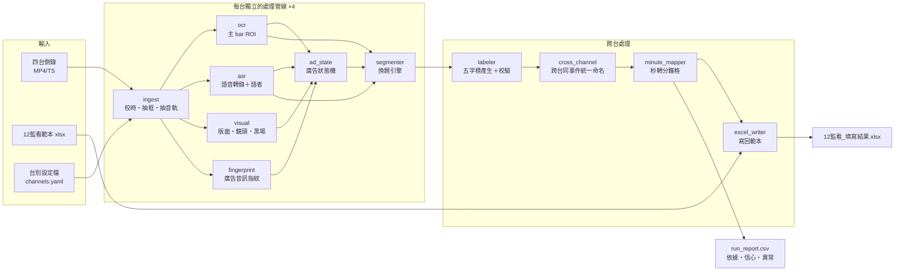
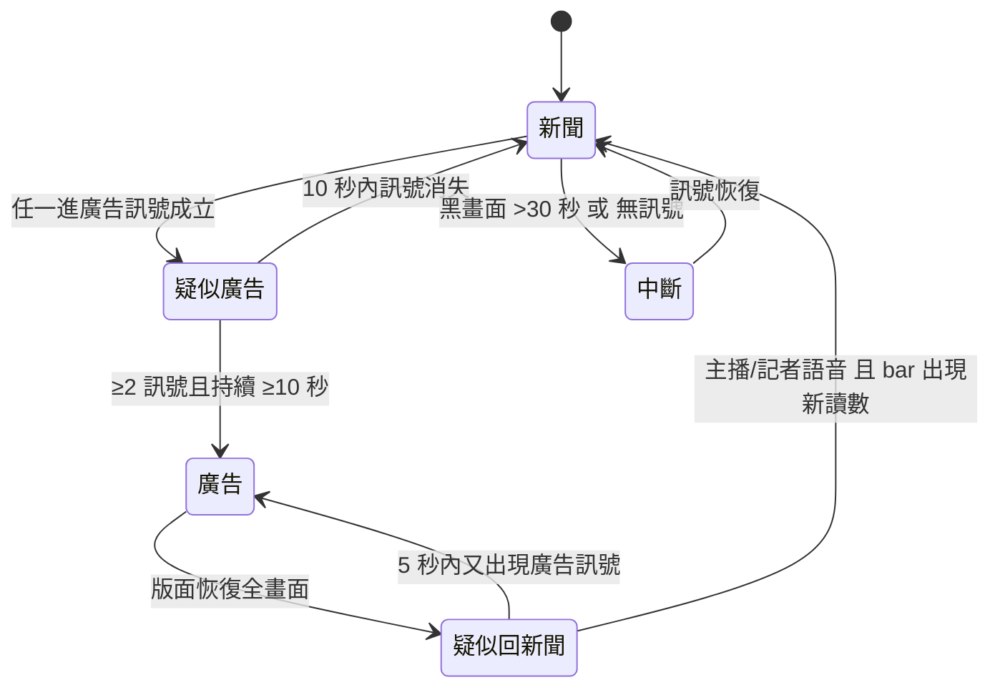
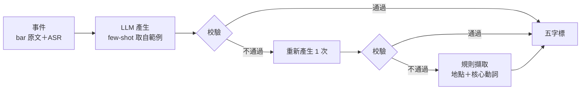
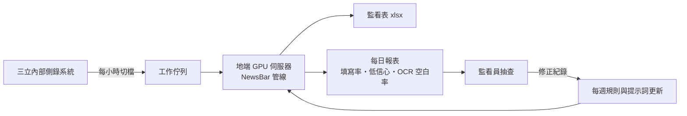

# NewsBar Copilot 系統架構

> 版本 v0.3（2026-11-18）｜狀態：決策邏輯與抽取端已實作（98 個自動測試），尚未用真實側錄驗證
> 對應提案：UNEXT AI 企業創新實戰營 S36「新聞監看全自動填表」
> **需求來源：[requirements.md](requirements.md)**（Contextual Design 工作模型 → 親和圖 → UED → 需求清單）。本文件的每個模組都標出它實現的需求 ID。

## 1. 目標與邊界

**做什麼**：輸入四個競台（民視、TVBS、東森、華視）同時段的側錄影片與「12監看」範本，系統自動判斷換題、廣告，產生五字標，寫回 Excel，過程不需人工逐則挑標、修正或補填。

**不做什麼（Non-goals）**

- 不填收視率欄（A30／M30／A4+）、不填三立自家欄
- 不新增欄位、不做秒級紀錄
- 不判斷新聞真偽或立場
- 不取代三立既有的內部側錄系統，只接在它後面

**驗收標準**（見 [evaluation](#9-評估)）：換題起始分鐘 F1 ≥0.85（±1 分鐘）、廣告分鐘 F1 ≥0.90、五字標可用率 ≥85% 且捏造 0、自動填寫率 100%、每 1 小時四台影片 ≤15 分鐘處理完。

## 2. 輸出格式契約（從 10/26 範例歸納）

這是整個系統最硬的約束，所有模組都為它服務。

| 情況 | 該台五字標欄的寫法 |
|---|---|
| 新的一則新聞開始 | 在開始那一分鐘填五字標，例：`土城翁輾亡` |
| 同一則延續 | 留白 |
| 同一分鐘換了兩則以上 | 以 `/` 並列，例：`持刀警開槍/台股二補跌` |
| 進廣告 | 在廣告開始那一分鐘填 `廣告`，之後留白直到回新聞 |
| 回到新聞 | 回來的第一個新聞分鐘**一律填標**（留白會被讀成「還在廣告」） |
| 主 bar 在報天氣 | 填 `氣象` |
| 訊號中斷且補抓失敗 | 填 `訊號中斷`【待業師確認】 |

範本結構：每分鐘一列（1200–1259）；每台一組欄位「五字標、A30、M30、A4+」；台別順序為三立、TVBS-N、東森、民視、華視。寫入時**只動四個競台的五字標欄**。

> 關鍵推論：空白不是「沒資料」，而是「延續前一個狀態」。因此系統任何「不確定就留白」的設計，都必須先確認留白的語意是對的。

## 3. 系統總覽



### 3.1 需求對應

| 模組 | 實現的需求 |
|---|---|
| ingest | FR-01、FR-20、FR-24、NFR-08 |
| ocr | FR-02、NFR-22 |
| asr、visual | FR-03、FR-04 |
| ad_state | FR-04、FR-05、FR-14、NFR-18 |
| segmenter | FR-03、FR-06、NFR-18 |
| labeler | FR-08、FR-10、FR-13 |
| cross_channel | FR-19 |
| minute_mapper | FR-06、FR-07、FR-09、FR-13、FR-14、C-01 |
| excel_writer | FR-11、C-02、C-03 |
| evidence（新增） | FR-12、NFR-13 |
| ui：抽查台、ROI 校正、日報 | FR-15、FR-16、FR-17、FR-18 |
| eval | FR-23 |
| fingerprint | FR-22 |
| rules 版本 | FR-21 |

設計原則：

1. **先判廣告、再判換題**：廣告區間內的 bar 文字一律不採用，從源頭擋掉包框殘留。
2. **規則可解釋優先，LLM 只做命名**：換題與廣告判斷用規則加分數融合，出錯時能追到是哪個訊號造成。LLM 只負責把已確定的事件寫成五字標，且受來源校驗。
3. **每格都由系統決定**：任何模組失效都有明確的 fallback，不停下來等人。
4. **中間產物全部落地**：每個階段輸出成檔案，可單獨重跑、單獨評估。

## 4. 模組設計

### 4.1 ingest：校時與抽取

| 項目 | 規格 |
|---|---|
| 輸入 | 每台一支影片；起點時間來自檔案時間碼，若沒有就 OCR 畫面上的時鐘 |
| 畫面 | FFmpeg 每秒抽 1 張，保留原解析度，只存 ROI 裁切圖以省空間 |
| 音訊 | 16kHz 單聲道 WAV |
| 輸出 | `frames/{channel}/{sec:05d}_{roi}.png`、`audio/{channel}.wav`、`ingest.json`（起點時間、長度、fps） |

### 4.2 ocr：主 bar 文字流

- 只讀 `channels.yaml` 定義的 `main_bar` ROI；跑馬燈、快訊、天氣角、側欄不在 ROI 內。
- 信心 < 0.6 的讀數丟棄。
- **5 秒滑動窗口多數決**：同一個 bar 在 5 秒內取出現最多次的讀法，抵銷單張辨識錯誤（Third Eye 原始 OCR 錯誤率高的教訓）。
- 跑馬燈防呆：若 ROI 內文字逐秒水平位移，判定為跑馬燈，整段丟棄並告警「ROI 可能設錯」。
- 輸出 `ocr/{channel}.jsonl`：`{sec, text, conf, votes}`

### 4.3 asr：語音轉錄

- VAD 切段，轉錄附時間戳。
- 語者切換偵測：用來找「主播稿頭」的開始。
- **只當輔助訊號**：台語、背景音樂、專有名詞會出錯，所以不直接拿來當五字標。
- 輸出 `asr/{channel}.jsonl`：`{start, end, text, speaker, topic_vec}`

### 4.4 visual：畫面結構訊號

- **版面相似度**：把畫面切成 3×3 區塊，和該台「正常新聞」參考畫面比 SSIM。包框時主畫面縮成側框，左右區塊相似度會明顯下降。
- **鏡頭切換**：PySceneDetect，用來找「切回主播台」。
- **黑場與靜音**：0.2–1 秒的黑畫面或靜音，常是廣告破口。
- **台徽存在**：台徽 ROI 的模板比對分數。
- 輸出 `visual/{channel}.jsonl`：`{sec, layout_sim, shot_cut, black, logo_score}`

### 4.5 fingerprint：廣告指紋庫

- Chromaprint 對每 5 秒音訊算指紋。
- 一旦某段被確定為廣告，就把指紋加入 `ad_library/`。同一支廣告會在多台、多天重播，第二次出現就能直接命中。
- 這個模組讓系統**越跑越準**，是長期護城河。

### 4.6 ad_state：廣告狀態機



進廣告訊號（任兩項同時成立）：

| 代號 | 訊號 | 來源 |
|---|---|---|
| a | 主畫面版面改變（包框） | visual.layout_sim |
| b | 台徽或新聞字卡消失 | visual.logo_score |
| c | 黑場或靜音破口 | visual.black |
| d | ASR 出現品牌、價格、促銷詞，且無主播或記者語音 | asr |
| e | 音訊指紋命中廣告庫 | fingerprint |

規則細節：

- 角落小廣告不改變主畫面版面，不算進廣告。
- 包框期間 bar 文字**凍結不採用**。
- 「bar 出現新讀數」= 與進廣告前最後一個讀數不同，避免把殘留文字當成回新聞。
- 電視台自家節目預告比照廣告【待業師確認】。

輸出 `segments/{channel}_ad.jsonl`：`{start, end, state, signals}`

### 4.7 segmenter：換題引擎

只在「新聞」狀態的區間內計算。

```
候選點：bar 文字改變（字元 Jaccard < 0.5）
         │
         ▼
同則排除：新舊 bar 句向量相似度 > 0.75，或人名/地名重疊 ≥1
         → 視為同一則的主標/副標輪播，不換題
         │
         ▼
融合分數 s = 0.5·S_bar + 0.3·S_asr + 0.2·S_visual
         S_bar    = 1 − 句向量相似度
         S_asr    = ASR 主題向量在候選點前後 20 秒的變化量；出現新語者再加分
         S_visual = 候選點 ±5 秒內有切回主播台 → 1，否則 0
         │
         ▼
s > 0.6 → 換題；時間取新 bar 第一次穩定出現的秒數
```

權重與門檻放在 `config/rules.yaml`，用 12:00–12:20 調參，12:20–13:00 只測試。

輸出 `segments/{channel}_stories.jsonl`：`{story_id, start, end, bar_texts[], asr_text, entities[], confidence}`

### 4.8 labeler：五字標產生器



校驗規則：

1. 長度 4–6 字（範例中也有英文標，如 `MUSIC EXPO`，英文以詞計）。
2. 標裡每個名詞都要能在 bar 原文或 ASR 中找到，**不能補造地點或動作**。
3. 社會新聞（分類器判定）必須含地點，且地點要出現在原文。
4. 不能把未確認的事寫成定論（原文有「疑」「傳」「恐」時，標不能刪掉這層語氣）。

### 4.9 cross_channel：跨台統一命名

範例中同一事件在多台使用同一個標（如 `中逼康永歉` 出現在東森、民視、華視）。在同一時段內，若兩台的事件實體重疊度高，後出現的沿用先出現的標。這讓收視分析能直接比較「同一事件在各台的分鐘收視」。

### 4.10 minute_mapper：秒轉分鐘格

- 事件起始秒數無條件捨去到 `HHMM`。
- 同一分鐘多個事件以 `/` 並列（依時間先後）。
- 廣告起始分鐘填 `廣告`；中斷起始分鐘填 `訊號中斷`。
- 從廣告或中斷回來的第一個新聞分鐘，強制填標。
- 其餘留白。

### 4.11 excel_writer：寫回範本

- openpyxl 讀範本，依表頭文字定位「時間列」與「台別的五字標欄」，不寫死座標。
- 寫入前後對**非目標儲存格**計算雜湊值，必須完全相同，確保只動到該動的格子。
- 輸出 `out/12監看_{date}.xlsx`；旁檔 `out/run_report.csv` 記錄每格的來源 bar 原文、秒級時間、信心、判斷依據。

### 4.12 evidence：每格的證據包（FR-12、NFR-13）

每個寫進表的格子都對應一筆證據，抽查台與評估都讀它：

```json
{
  "channel": "cts", "minute": "1232", "value": "廣告",
  "event_start_sec": 1924,
  "source": {"bar_text": "…", "asr_text": "…", "frame": "frames/cts/01924_main_bar.png"},
  "signals": {"layout_change": true, "black": true, "logo": false},
  "confidence": 0.91,
  "fallback": null,
  "rules_version": "0.1"
}
```

存成 `out/evidence.jsonl`；`run_report.csv` 是它的扁平版。

## 5. 介面層（依 UED，見 requirements §5）

| Focus Area | Demo 版（11/22） | 正式版 |
|---|---|---|
| 1 執行台 | `newsbar run` CLI，終端顯示各台各階段進度 | 內網 Web，接側錄切檔自動排程 |
| 2 監看表交付 | `out/12監看_{date}.xlsx` | 原始版＋修正版，放共用資料夾 |
| 3 抽查台 | `newsbar review` 產生靜態 HTML：四台時間軸並列，低信心與 fallback 排最前，每格附 bar 截圖、依據、信心 | 內網 Web，可播放 ±10 秒片段、標對錯、輸入正確寫法，寫入修正紀錄 |
| 4 ROI 校正 | `tools/calibrate_roi.py`：開截圖框選，存 channels.yaml，即時印出 OCR 結果 | 內網 Web 版 |
| 5 品質日報 | `newsbar eval` 輸出 HTML 報告 | 每日自動寄送＋告警 |
| 6 規則版本 | rules.yaml 進 git | Web 檢視版本與各版 F1、一鍵退版 |

抽查台的錯誤類型與 eval 的錯誤歸類共用同一份清單（`schemas.ErrorType`）：漏換題、過度換題、包框誤判、角落廣告誤判、標不可辨認、捏造、格式錯誤。

## 6. Fallback 表（保證每格由系統決定）

| 失效情況 | 系統動作 | 在表上的結果 |
|---|---|---|
| 換題信心低 | 視為延續 | 留白（語意正確：同一則延續） |
| 廣告訊號互相衝突 | 依多數決 | 依結果填或不填 |
| OCR 讀不到 | 改用 ASR 摘要產生五字標，仍需通過校驗 | 填標 |
| LLM 校驗兩次失敗 | 規則擷取「地點＋核心動詞」 | 填標 |
| 訊號中斷 | 先從內部側錄補抓重跑；仍失敗才標記 | `訊號中斷` |

每一筆 fallback 都寫進 `run_report.csv` 的 `fallback` 欄，供每日抽查優先查看。

## 7. 技術選型

採「介面固定、後端可換」：開發機與正式機用不同後端，但輸出格式相同。

| 模組 | 介面 | 開發機（Mac M4, 16GB） | 正式機（地端 GPU 伺服器） | 理由與限制 |
|---|---|---|---|---|
| 影音處理 | — | FFmpeg | FFmpeg | 業界標準 |
| OCR | `OcrBackend.read(img) -> [(text, conf)]` | Apple Vision（系統內建繁中，免下載模型） | PaddleOCR PP-OCR | Vision 省磁碟、快；PaddleOCR 可跨平台、可微調 |
| ASR | `AsrBackend.transcribe(wav) -> segments` | mlx-whisper（Apple GPU） | faster-whisper large-v3-turbo | 台語與專有名詞較弱，只當輔助 |
| 句向量 | `Embedder.encode(texts)` | bge-m3 或同級多語模型 | 同左 | 判斷同則與跨台同事件 |
| 版面／鏡頭 | — | OpenCV、PySceneDetect | 同左 | — |
| 音訊指紋 | — | Chromaprint (`fpcalc`) | 同左 | — |
| LLM | `Labeler.generate(event) -> str` | Ollama 地端小模型 | Ollama 地端模型；雲端 API 只作備援 | 會捏造，所以一定經過校驗 |
| Excel | — | openpyxl | openpyxl | 保留原格式 |

語言：Python 3.11（套件相容性最好）。套件管理：uv。

## 8. 專案結構

```
newsbar-copilot/
├── README.md
├── pyproject.toml
├── config/
│   ├── channels.example.yaml   # 每台 ROI、台徽、bar 色
│   └── rules.example.yaml      # 門檻與融合權重
├── src/newsbar/
│   ├── cli.py                  # newsbar run / eval / calibrate
│   ├── pipeline.py             # 串接各階段，支援從任一階段重跑
│   ├── ingest.py
│   ├── ocr/        {base.py, vision_backend.py, paddle_backend.py}
│   ├── asr/        {base.py, mlx_backend.py, faster_whisper_backend.py}
│   ├── visual.py
│   ├── fingerprint.py
│   ├── ad_state.py
│   ├── segmenter.py
│   ├── labeler/    {base.py, prompt.py, validator.py, rule_fallback.py}
│   ├── cross_channel.py
│   ├── minute_mapper.py
│   ├── excel_writer.py
│   ├── evidence.py             # 每格的證據包
│   ├── review/                 # 抽查台：產生 HTML、讀寫修正紀錄
│   └── schemas.py              # 所有中間產物的資料結構與 ErrorType
├── tools/
│   ├── calibrate_roi.py        # 開一張截圖，框選 ROI，存進 channels.yaml
│   └── annotate.py             # 標註工具：產生標準答案
├── eval/
│   ├── metrics.py              # 換題 F1、廣告 F1、五字標 rubric
│   └── gold/                   # 雙人標註結果（不含影片）
├── tests/
└── data/                       # 影片與中間產物，.gitignore 排除
```

## 9. 評估

| 指標 | 計算方式 | 目標 | 權重 |
|---|---|---|---|
| 換題起始分鐘 F1 | 與標準答案比對，容許 ±1 分鐘 | ≥0.85 | 25% |
| 廣告分鐘 F1 | 以分鐘為單位，誤判與漏判都算 | ≥0.90 | 20% |
| 五字標可用率 | rubric 盲評，捏造須為 0 | ≥85% | 20% |
| 自動填寫率 | 不需人工補格即可交付 | 100% | 10% |
| 每日人工時數 | 班表統計 | ≤3 小時 | 10% |
| 處理速度 | 每 1 小時四台影片 | ≤15 分鐘 | 10% |
| 單位成本 | 年成本 ÷ 處理台時數 | ≤NT$10／台時 | 5% |

- 標準答案：兩人依判準手冊獨立標註，Cohen's κ ≥0.8，分歧由第三人裁決。
- 對照組：(a) 只看 bar 文字變化的單訊號基線；(b) 本系統。
- `newsbar eval` 一次跑完所有指標並輸出錯誤歸類（漏換題、過度換題、包框誤判、捏造…）。

## 10. 部署

**Demo（11/22 前）**：Mac 單機，批次處理 11/06 12:00–13:00 四台影片，輸出 Excel 與評估報告。

**正式上線**：



- 影片不出內網，只保存文字結果。
- 規則與提示詞有版本號；週 F1 連兩週 <0.75 自動退回上一版。

## 11. 待決事項

見 [requirements.md §6.5](requirements.md#65-待決事項)（Q1–Q10），兩邊不重複維護。

## 12. 實作狀態

| 步驟 | 內容 | 狀態 |
|---|---|---|
| 1 骨架與契約 | schemas、minute_mapper、excel_writer、evidence | ✅ |
| 2 抽取端 | ingest、OCR（Apple Vision／PaddleOCR）、投票、跑馬燈防呆、ROI 校正 CLI | ✅ |
| 3 廣告 | 狀態機、畫面訊號（版面邊界、包框樣板、bar 底色、台徽、黑場、靜音）、聲音指紋庫 | ✅ |
| 4 換題 | 穩定 bar、同則判斷（字詞基線）、語音主題佐證、OCR 失效改用語音 | ◐ 主播鏡頭偵測、語者切換未做 |
| 5 五字標 | 校驗器、規則擷取、Ollama／Claude 產生器 | ✅ |
| 6 評估與抽查 | `newsbar eval`、抽查 HTML、修正版 | ✅ |
| 7 營運 | `newsbar run`：平行、續跑、單台失敗隔離、處理報告、跨台命名 | ✅ |
| 8 營運補強 | `newsbar watch` 每小時自動處理、截圖保留期限清理、抽查審核者 | ✅ |
| 9 未做 | 主播鏡頭偵測、語者切換、圖形化 ROI 校正、日報寄送、自動退版、歷史檢索、畫面時鐘 OCR | ○ |

**下一步**：拿到 11/06 側錄後依 requirements §7 先做自我觀察與雙人標註，再以 12:00–12:20 調參、12:20–13:00 測試，把 NFR-01–03 的實測值填回需求表。
