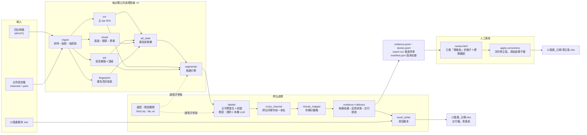
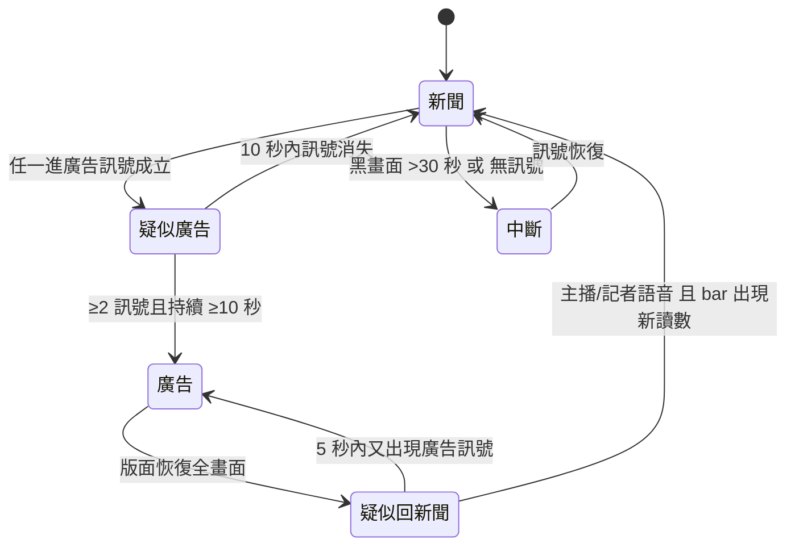
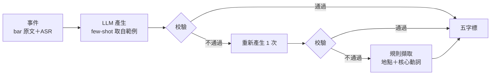
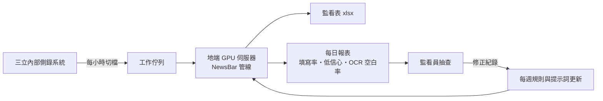

# NewsBar Copilot 系統架構

> 版本 v0.3（文件日期 2026-11-22）｜狀態：決策邏輯與抽取端已實作並有自動測試；已用一段真實側錄驗證（11/06 12:00–13:00），標準答案為單一標註者的暫定版（TVBS 一台、一位研究員），尚無獨立驗證
> 對應提案：UNEXT AI 企業創新實戰營 S36「新聞監看全自動填表」
> **需求來源：[requirements.md](requirements.md)**（Contextual Design 工作模型 → 親和圖 → UED → 需求清單）。本文件的每個模組都標出它實現的需求 ID。

## 1. 目標與邊界

**做什麼**：輸入四個競台（民視、TVBS、東森、華視）同時段的側錄影片與「12監看」範本，系統自動判斷換題、廣告，產生五字標，寫回 Excel，過程不需人工逐則挑標、修正或補填。

**不做什麼（Non-goals）**

- 不填收視率欄（A30／M30／A4+）、不填三立自家欄
- 不新增欄位、不做秒級紀錄
- 不判斷新聞真偽或立場
- 不取代三立既有的內部側錄系統，只接在它後面

**驗收標準**（見 [evaluation](#9-評估)）：換題起始分鐘 F1 ≥0.85（±1 分鐘）、廣告分鐘 F1 ≥0.90、五字標可用率 ≥85% 且捏造 0、自動填寫率 100%、每 1 小時四台影片 ≤15 分鐘處理完。

## 2. 輸出格式契約（從 10/26 範例歸納）

這是整個系統最硬的約束，所有模組都為它服務。

| 情況 | 該台五字標欄的寫法 |
|---|---|
| 新的一則新聞開始 | 在開始那一分鐘填五字標，例：`土城翁輾亡` |
| 同一則延續 | 留白 |
| 同一分鐘換了兩則以上 | 以 `/` 並列，例：`持刀警開槍/台股二補跌` |
| 進廣告 | 在廣告開始那一分鐘填 `廣告`，之後留白直到回新聞 |
| 回到新聞 | 回來的第一個新聞分鐘**一律填標**（留白會被讀成「還在廣告」） |
| 主 bar 在報天氣 | 填 `氣象` |
| 訊號中斷且補抓失敗 | 填 `訊號中斷`【待業師確認】 |

範本結構：每分鐘一列（1200–1259）；每台一組欄位「五字標、A30、M30、A4+」；台別順序為三立、TVBS-N、東森、民視、華視。寫入時**只動四個競台的五字標欄**。

> 關鍵推論：空白不是「沒資料」，而是「延續前一個狀態」。因此系統任何「不確定就留白」的設計，都必須先確認留白的語意是對的。

## 3. 系統總覽



**一次執行的完整流程**（`newsbar run`）：

1. 讀影片、對畫面時鐘校時；四台平行（語音在 Mac 上一次一台）。
2. 擷取文字、語音、聲音指紋、版面；結果存成 `obs.jsonl`，旁邊的 `obs.meta.json` 記下影片指紋與擷取設定。`--resume` 只在這些都沒變時沿用（RUN-1）。
3. 判廣告、判換題（見 §4.6、§4.7），每個換題點附理由代碼與證據。
4. 寫五字標：AI 先寫、逐條檢查；只差字數或寫成簡體字就直接修正（LBL-10）；仍不過就重試一次，最後才用規則擷取（FB-4）。
5. 秒轉分鐘格，每一格產生依據與品質狀態：自動通過或需複查（QA-1）。
6. 交付檢查（QA-2）：範圍、每台第一格、字數、依據齊全、待複查幾格 → 「可直接交付／可交付但含待複查項目／不完整」。
7. 寫回 Excel（交付檔零黃底；`--review-copy` 另存標黃的複查版），並寫處理報告與版本紀錄 `manifest.json`（RUN-2）。
8. **人工複查**：監看員開 `review.html`，只看「需複查」的格子（備援標籤、低信心、換題沒有佐證、短播報、包框文字），對照標題截圖與時間點，每格選「對／錯，改成…／不可用」，匯出 `corrections.json`，用 `newsbar apply-corrections` 另存修正版 Excel 與修正版依據檔：「對」→ HUMAN_APPROVED、「改成」→ HUMAN_APPROVED 並記下修正值、「不可用」→ REJECTED，連同複查人與時間。終端機印出確認／修正／退回／仍待複查各幾格。原始結果與依據檔不會被覆寫。

### 3.1 需求對應

| 模組 | 實現的需求 |
|---|---|
| ingest | FR-01、FR-20、FR-24、NFR-08 |
| ocr | FR-02、NFR-22 |
| asr、visual | FR-03、FR-04 |
| ad_state | FR-04、FR-05、FR-14、NFR-18 |
| segmenter | FR-03、FR-06、NFR-18 |
| labeler | FR-08、FR-10、FR-13 |
| cross_channel | FR-19 |
| minute_mapper | FR-06、FR-07、FR-09、FR-13、FR-14、C-01 |
| excel_writer | FR-11、C-02、C-03 |
| evidence（新增） | FR-12、NFR-13 |
| ui：抽查台、ROI 校正、日報 | FR-15、FR-16、FR-17、FR-18 |
| eval | FR-23 |
| fingerprint | FR-22 |
| rules 版本 | FR-21 |

設計原則：

1. **先判廣告、再判換題**：廣告區間內的 bar 文字一律不採用，從源頭擋掉包框殘留。
2. **規則可解釋優先，LLM 只做命名**：換題與廣告判斷用規則加分數融合，出錯時能追到是哪個訊號造成。LLM 只負責把已確定的事件寫成五字標，且受來源校驗。
3. **每格都由系統決定**：任何模組失效都有明確的 fallback，不停下來等人。
4. **中間產物全部落地**：每個階段輸出成檔案，可單獨重跑、單獨評估。

## 4. 模組設計

### 4.1 ingest：校時與抽取

| 項目 | 規格 |
|---|---|
| 輸入 | 每台一支影片；起點時間來自檔案時間碼，若沒有就 OCR 畫面上的時鐘 |
| 畫面 | FFmpeg 每秒抽 1 張，保留原解析度，只存 ROI 裁切圖以省空間 |
| 音訊 | 16kHz 單聲道 WAV |
| 輸出 | `frames/{channel}/{sec:05d}_{roi}.png`、`audio/{channel}.wav`、`ingest.json`（起點時間、長度、fps） |

### 4.2 ocr：主 bar 文字流

- 只讀台別設定檔（`config/channels.*.yaml`，見 §8）定義的 `main_bar` ROI；跑馬燈、快訊、天氣角、側欄不在 ROI 內。
- 信心低於門檻的讀數丟棄，門檻依 OCR 後端而定：PaddleOCR 0.6；Apple Vision 的信心值只有 0.3、0.5、1.0 三級，門檻為 0.3（以 [rules.md](rules.md) TXT-4 為準）。
- **5 秒滑動窗口多數決**：同一個 bar 在 5 秒內取出現最多次的讀法，抵銷單張辨識錯誤（Third Eye 原始 OCR 錯誤率高的教訓）。
- 跑馬燈防呆：若 ROI 內文字逐秒水平位移，判定為跑馬燈，整段丟棄並告警「ROI 可能設錯」。
- 輸出 `ocr/{channel}.jsonl`：`{sec, text, conf, votes}`

**讀錯字的處理（11/22 實測）：**

- 標題中位數信心 0.4 以下的一則，列入複查，理由「標題可能讀錯」（TXT-10）。Apple Vision 的繁中信心只有 0.3／0.5／1.0 三級：0.5 是多數台的正常值，分不出好壞；0.3 幾乎都是讀壞的（專冢澬金收芋、競緦 挨 蟲 沒磑貌、昔曰龍頭）。
- 試過、沒有採用：
  - **自訂詞（customWords）**：把詞庫和正確詞（促銷、拒檢、摜破、昔日）餵給 Vision，讀錯的那幾格結果完全不變；Vision 對繁中也只給一個候選讀法，沒有備選可挑。
  - **用語音自動改錯字**：真正讀錯的 4 個詞裡，只有「偷瀆→偷渡」在附近的語音裡聽得到正確詞；其餘標題出現時記者在講別的、語音本身也有錯。同一套規則卻產生 208 個錯誤修改（例：台達電→台積電）。語音辨識錯的是同音字、文字辨識錯的是形近字，不能拿一個去改另一個。
- 之後的方向：複查時記錄「錯誤類型＝文字辨識錯字」與正確寫法，累積成本台常見的形近字對照表；資料夠了再考慮微調 PaddleOCR。

### 4.3 asr：語音轉錄

- VAD 切段，轉錄附時間戳。
- 語者切換偵測：用來找「主播稿頭」的開始。
- **只當輔助訊號**：台語、背景音樂、專有名詞會出錯，所以不直接拿來當五字標。
- 輸出 `asr/{channel}.jsonl`：`{start, end, text, speaker, topic_vec}`

### 4.4 visual：畫面結構訊號

- **版面相似度**：把畫面切成 3×3 區塊，和該台「正常新聞」參考畫面比 SSIM。包框時主畫面縮成側框，左右區塊相似度會明顯下降。
- **鏡頭切換**：PySceneDetect，用來找「切回主播台」。
- **黑場與靜音**：0.2–1 秒的黑畫面或靜音，常是廣告破口。
- **台徽存在**：台徽 ROI 的模板比對分數。
- 輸出 `visual/{channel}.jsonl`：`{sec, layout_sim, shot_cut, black, logo_score}`

### 4.5 fingerprint：廣告指紋庫

- Chromaprint 對每 5 秒音訊算指紋。
- 一旦某段被確定為廣告，就把指紋加入 `ad_library/`。同一支廣告會在多台、多天重播，第二次出現就能直接命中。
- 這個模組讓系統**越跑越準**，是長期護城河。

### 4.6 ad_state：廣告狀態機



進廣告訊號（十種，任兩種同時成立且連續 10 秒）。**以 [rules.md](rules.md)（AD-1、AD-a 至 AD-j）為準**，下表為摘要：

| 代號 | 訊號 |
|---|---|
| a | 主畫面版面改變（包框） |
| b | 標題條底色和該台設定的顏色差太遠 |
| c | 台標消失或位置改變 |
| d | 黑畫面 |
| e | 語音出現品牌、價格、促銷詞，且無主播或記者講話 |
| f | 聲音指紋命中已知廣告 |
| g | 新聞跑馬燈不見（僅限多數時間有跑馬燈的頻道） |
| h | 標題條位置出現廣告文案（電話、0800、「廣告後」等） |
| i | 標題輪播（廣告包框內的新聞預告輪播） |
| j | 頻道時鐘消失 |

回新聞條件（上方狀態圖為簡化版）：完整五項條件見 rules.md AD-7，其中第（5）項為「此時廣告訊號不能還有兩種以上」。

規則細節：

- 角落小廣告不改變主畫面版面，不算進廣告。
- 包框期間 bar 文字**凍結不採用**。廣告還沒確認的前幾秒也一樣：主畫面縮成框又有另一種廣告訊號（跑馬燈還在時要另外兩種），或標題條是廣告文案，這一秒的字當作外框 UI（`commercial_overlay`，規則 AD-OVL），不參與換題比對，也不當殘留標題。
- 「bar 出現新讀數」= 與進廣告前最後一個讀數不同，避免把殘留文字當成回新聞。
- 電視台自家節目預告比照廣告【待業師確認】。

輸出 `segments/{channel}_ad.jsonl`：`{start, end, state, signals}`

### 4.7 segmenter：換題引擎

只在「新聞」狀態的區間內計算。原則：**鏡頭切換不等於換新聞**。換鏡頭、換人臉、LIVE 字樣、標題條消失都不會單獨觸發換題（BAN-1、BAN-2），它們最多是佐證；決定換題的是「穩定的新標題」加上語意或結構上的佐證。規則逐條以 [rules.md](rules.md) ③ 為準，下面是流程摘要。

```
候選點：主標題出現新字，且連續 7 秒讀到同一個（NEW-1、TIME-1）
        名條、天氣字樣、標題輪播、包框廣告外框上的字不算候選（SAME-7、TXT-5、CAROUSEL、AD-OVL）
         │
         ▼
同則排除：和目前這則任何一個標題共有連續兩個中文字 → 主副標輪播，不換題（SAME-3）
         │
         ▼
佐證：NEW-2a 前後 20 秒語音主題不同；NEW-2b 前後 5 秒切回主播台；NEW-2d 名條預告
      NEW-2e 之後 30 秒的語音講的是新標題的詞，舊標題的詞已聽不到
      NEW-2c 講話的人換了，只記錄、不單獨算數
         │
         ▼
有語音但沒有任何佐證 → 留在同一則（SAME-6）；沒有語音又沒佐證 → 換題但低信心（FB-1）
         │
         ▼
後處理：180 秒內標題回來（相似度 0.8 或共有 2 組兩字詞）→ 中間段落併回同一則（SAME-8）
        只靠語音佐證、不到 15 秒的「新聞」→ 是前一則的收尾，併回（SAME-9）
        廣告前不到 20 秒的「新聞」併入廣告（NEW-3），完整的短播報除外（BRIEF-1）
        廣告後回來：殘留標題＋同語音主題 → 沿用原則（AD-8）；逾時 → 靠語音命名（AD-9）
```

`segmenter.mode: learned` 時，候選點改由模型算出的機率決定（見 rules.md ⑦）。

四種容易誤判的播出情境怎麼處理：

| 情境 | 處理 |
|---|---|
| 主播稿頭背板有動畫、沒有主標題條 | 標題條消失不是候選點；目前這則延續到下一個穩定新標題。還沒讀到任何標題時，靠語音主題換題（FB-3，低信心） |
| 外場記者先開場、人臉頻繁切換 | 人臉沒有用來判斷；講話的人換了只記錄（NEW-2c），不會單獨換題 |
| 沒進完整專題的短播報 | 一般情況照常算一則；廣告前不到 20 秒時，符合 BRIEF-1（穩定新標題＋至少一項佐證＋有新聞語音、語音主題沒延續進廣告、和前 180 秒的新聞沒有共同詞、標題不是廣告文案）就保留，並一律送複查 |
| 廣告包框 | 狀態機判廣告（AD-1、AD-a/i）；確認前的過渡秒數由 AD-OVL 擋掉外框文字；回新聞時重新判斷是同一則回來（AD-8）還是下一則 |

每個段落另外輸出換題證據（EVD-1、EVD-2）：理由代碼 `reason_codes`（HEADLINE_CHANGED、TOPIC_SHIFT、ANCHOR_SHOT、SPEECH_FOLLOWS_HEADLINE…）、`evidence`（標題換新、語音主題換了、切回主播台、換人講話、名條預告、語音跟著新標題、和前一則標題相似度、是否在廣告後、是否合併、是否短播報、包框文字秒數）與 `review_required`。規則模式**不給分數**：沒有用獨立資料校準過的數字不當機率用；學習模式才附模型原始分數，標明 `learned_model_uncalibrated`。低信心、備援、只有標題換了而沒有佐證、短播報或出現過包框文字的段落標成需複查。

為什麼要 NEW-2e：語音主題編號幾乎每句話都換（11/06 民視 40 秒內 t347→t353），前後 20 秒很少完全不同，NEW-2a 常常抓不到，SAME-6 就把真的換題吞掉（民視巴拉圭總統→幼兒園過馬路→涼圓店被併成一則）。比對「新標題的詞有沒有出現在接下來的語音」比較可靠。

輸出 `out/12監看_{date}.stories.jsonl`，一個段落一行：`{run_id, channel, story_id, type, label, start_sec, end_sec, bar_text, confidence, fallback, boundary_kind, score, score_source, reason_codes, evidence, review_required, signals}`。

門檻放在規則設定檔（`config/rules.*.yaml`，範本為 `rules.example.yaml`；`config/rules.yaml` 為本機自建、已 gitignore）。程式實際讀的 segmenter 鍵是 `stable_sec`、`credit_max_sec`、`credit_window_sec`、`asr_veto`、`asr_window_sec`、`visual_window_sec`、`mode`、`model`；範本裡的 `bar_change_jaccard`、`same_story_cosine`、`weights`、`threshold` 是早期加權融合設計留下的，程式沒有讀。調參用 12:00–12:20，測試用 12:20–13:00；12:20–13:00 並非獨立保留集，部分門檻參考過 11/06 資料。

#### 4.7.1 還沒做的部分（後續路線）

以下是「新聞故事單元分割」完整做法中，目前程式還沒有的部分，依優先順序：

1. **語意與實體連續性**：現在同則判斷看標題共有詞（SAME-3、SAME-8）、語音主題編號（NEW-2a）和「語音是否跟著新標題」（NEW-2e）。下一步加句向量相似度與人名、地名、機構重疊。已知限制：語音辨識把專有名詞聽錯時（「河口湖」→「核口糊」）NEW-2e 抓不到；共有「起火」這類詞的兩則火災新聞會被 SAME-3 併成一則。
2. **子段類型分類**：在每則新聞內標出主播稿頭、SOT、Live、假連線、說新聞、記者補充。需要人臉／說話人辨識（現在只有音高跳動的簡易版）與棚內／外景版面分類。這不影響五字標，但可以支援更細的監看。
3. **序列修正**：現在是單次規則掃描加後處理（SAME-8、NEW-3、AD-10、AD-11）。可以改成 HMM、CRF 或動態規劃，把整小時當一條狀態序列一起解。
4. **背板 OCR**：無標題條的稿頭時，讀主播背板上的字當佐證。
5. **標註集**：上面幾項都需要三立實際播出的雙人標註資料（故事 ID、起訖、子段類型、難例標籤），並保留一組不參與調參的盲測集。現在只有 TVBS 一小時的研究者初標。
6. **評估指標**：秒級邊界、切太碎／併太多、廣告誤入秒數已有（EVAL-2，見 §9）；子段分類 F1、複查後修正率還沒有。

### 4.8 labeler：五字標產生器



校驗規則：

1. 長度 4–6 字（範例中也有英文標，如 `MUSIC EXPO`，英文以詞計）。
2. 標裡每個名詞都要能在 bar 原文或 ASR 中找到，**不能補造地點或動作**。
3. 社會新聞（分類器判定）必須含地點，且地點要出現在原文。
4. 不能把未確認的事寫成定論（原文有「疑」「傳」「恐」時，標不能刪掉這層語氣）。

### 4.9 cross_channel：跨台統一命名

範例中同一事件在多台使用同一個標（如 `中逼康永歉` 出現在東森、民視、華視）。在同一時段內，若兩台的事件實體重疊度高，後出現的沿用先出現的標。這讓收視分析能直接比較「同一事件在各台的分鐘收視」。

### 4.10 minute_mapper：秒轉分鐘格

- 事件起始秒數無條件捨去到 `HHMM`。
- 同一分鐘多個事件以 `/` 並列（依時間先後）。
- 廣告起始分鐘填 `廣告`；中斷起始分鐘填 `訊號中斷`。
- 從廣告或中斷回來的第一個新聞分鐘，強制填標。
- 其餘留白。

### 4.11 excel_writer：寫回範本

- openpyxl 讀範本，依表頭文字定位「時間列」與「台別的五字標欄」，不寫死座標。
- 寫入前後對**非目標儲存格**計算雜湊值，必須完全相同，確保只動到該動的格子。
- 輸出 `out/12監看_{date}.xlsx`；旁檔 `out/run_report.csv` 記錄每格的來源 bar 原文、秒級時間、信心、判斷依據。

### 4.12 evidence：每格的證據包（FR-12、NFR-13）

每個寫進表的格子都對應一筆證據，抽查台與評估都讀它：

```json
{
  "channel": "cts", "minute": "1232", "value": "廣告",
  "items": [{"type": "ad", "label": null, "start_sec": 1924, "bar_text": "…", "asr_text": "…",
             "frame": "frames/cts/01924_main_bar.png", "boundary": {"kind": "ad", "boundary_probability": 1.0, "evidence": {…}, "review_required": false}}],
  "signals": ["AD-a", "AD-d"],
  "confidence": "high",
  "fallback": null,
  "reasons": [],
  "rules_version": "0.1",
  "run_id": "run_20261122_173212",
  "quality": {"status": "AUTO_ACCEPTED", "reason_codes": ["BACK_FROM_BREAK"], "reasons": [],
              "reviewer": null, "reviewed_at": null, "corrected_value": null}
}
```

`quality.status`（QA-1）：AUTO_ACCEPTED 自動通過、REVIEW_REQUIRED 需複查、HUMAN_APPROVED 人工確認、REJECTED 人工退回。複查版的黃底由它產生，顏色不是唯一紀錄。執行狀態另記在處理報告 `execution_status`（每台 SUCCEEDED／FAILED），兩者不混用。

### 4.13 delivery 與 runinfo：交付檢查與版本紀錄

- `delivery.validate_delivery`（QA-2）：寫 Excel 前檢查範圍、每台第一格、字數、每格有依據、待複查數，結果是 READY／READY_WITH_REVIEW／INCOMPLETE，寫在 `report.json` 的 `delivery` 並印在終端機。只說明，不擋寫入。11/22 實測它抓到一次平行命名時整台失敗（系統斷詞元件在多執行緒下出錯，已修）。
- `runinfo`（RUN-1、RUN-2）：每次執行寫 `<out>.manifest.json`：執行編號、git commit（含是否有未提交修改）、設定檔雜湊、影片與範本指紋（大小＋頭尾各 4 MB 雜湊）、OCR／語音／AI 模型、哪幾台沿用或重新擷取。每格依據與每則新聞都帶 `run_id`。
- 各步驟狀態（RUN-3）：每台擷取記下裁切、文字辨識、畫面、語音各自成功／失敗／略過（`stages.json`，也寫進報告與版本紀錄）。語音轉錄失敗回報「失敗」而不是「沒人講話」，下次續跑不沿用；整台失敗的原因分 INPUT／TRANSIENT／BUG。
- 五字標斷詞（LBL-9）：`words.py` 在 Mac 上用系統內建的繁體中文斷詞（CoreFoundation／ICU），加 jieba 詞典；其他系統只用 jieba。不新增套件。

存成 `out/12監看_{date}.evidence.jsonl`；`report.csv` 是它的扁平版（複查清單）。以段落為單位的換題證據另存 `stories.jsonl`（見 §4.7）。

## 5. 介面層（依 UED，見 requirements §5）

| Focus Area | Demo 版（11/22） | 正式版 |
|---|---|---|
| 1 執行台 | `newsbar run` CLI，終端顯示各台各階段進度 | 內網 Web，接側錄切檔自動排程 |
| 2 監看表交付 | `out/12監看_{date}.xlsx` | 原始版＋修正版，放共用資料夾 |
| 3 抽查台 | `newsbar review` 產生靜態 HTML：四台時間軸並列，低信心與 fallback 排最前，每格附 bar 截圖、依據、信心 | 內網 Web，可播放 ±10 秒片段、標對錯、輸入正確寫法，寫入修正紀錄 |
| 4 ROI 校正 | `newsbar calibrate`（實作在 `src/newsbar/calibrate_ui.py`）：開截圖框選，存進台別設定檔，即時印出 OCR 結果 | 內網 Web 版 |
| 5 品質日報 | `newsbar eval` 輸出 HTML 報告 | 每日自動寄送＋告警 |
| 6 規則版本 | 規則設定檔（`config/rules.*.yaml`）進 git | Web 檢視版本與各版 F1、一鍵退版 |

抽查台的錯誤類型與 eval 的錯誤歸類共用同一份清單（`schemas.ErrorType`）：漏換題、過度換題、包框誤判、角落廣告誤判、標不可辨認、捏造、格式錯誤。

## 6. Fallback 表（保證每格由系統決定）

| 失效情況 | 系統動作 | 在表上的結果 |
|---|---|---|
| 換題信心低 | 視為延續 | 留白（語意正確：同一則延續） |
| 廣告訊號互相衝突 | 依多數決 | 依結果填或不填 |
| OCR 讀不到 | 改用 ASR 摘要產生五字標，仍需通過校驗 | 填標 |
| LLM 校驗兩次失敗 | 規則擷取「地點＋核心動詞」 | 填標 |
| 訊號中斷 | 先從內部側錄補抓重跑；仍失敗才標記 | `訊號中斷` |

每一筆 fallback 都寫進 `run_report.csv` 的 `fallback` 欄，供每日抽查優先查看。

## 7. 技術選型

採「介面固定、後端可換」：開發機與正式機用不同後端，但輸出格式相同。

| 模組 | 介面 | 開發機（Mac M4, 16GB） | 正式機（地端 GPU 伺服器） | 理由與限制 |
|---|---|---|---|---|
| 影音處理 | — | FFmpeg | FFmpeg | 業界標準 |
| OCR | `OcrBackend.read(img) -> [(text, conf)]` | Apple Vision（系統內建繁中，免下載模型） | PaddleOCR PP-OCR | Vision 省磁碟、快；PaddleOCR 可跨平台、可微調 |
| ASR | `AsrBackend.transcribe(wav) -> segments` | mlx-whisper（Apple GPU） | faster-whisper large-v3-turbo | 台語與專有名詞較弱，只當輔助 |
| 句向量 | `Embedder.encode(texts)` | bge-m3 或同級多語模型 | 同左 | 判斷同則與跨台同事件 |
| 版面／鏡頭 | — | OpenCV、PySceneDetect | 同左 | — |
| 音訊指紋 | — | Chromaprint (`fpcalc`) | 同左 | — |
| LLM | `Labeler.generate(event) -> str` | Ollama 地端小模型（目前結果用 qwen2.5:7b） | Ollama 地端模型；外部 LLM（Claude）為選配、預設關閉，只作備援 | 會捏造，所以一定經過校驗 |
| Excel | — | openpyxl | openpyxl | 保留原格式 |

語言：Python 3.11（套件相容性最好）。套件管理：uv。

## 8. 專案結構

```
newsbar-copilot/
├── README.md
├── pyproject.toml
├── config/                     # channels.yaml／rules.yaml 為本機自建、已 gitignore
│   ├── channels.example.yaml   # 每台 ROI、台徽、bar 色（範本）
│   ├── channels.1106.yaml      # 11/06 四台實際設定
│   ├── rules.example.yaml      # 門檻與融合權重（範本）
│   ├── rules.1106.yaml、rules.1106.fast.yaml、rules.gpu.yaml
│   └── lexicon.yaml
├── src/newsbar/
│   ├── cli.py                  # newsbar run / eval / calibrate / annotate / gold-import / review / serve ...
│   ├── pipeline.py             # 串接各階段，支援從任一階段重跑
│   ├── ingest.py、extract.py、clock.py
│   ├── ocr/        {__init__.py, base.py, vision_backend.py, paddle_backend.py, stream.py}
│   ├── asr/        {__init__.py, mlx_backend.py, faster_whisper_backend.py}
│   ├── visual.py
│   ├── fingerprint.py
│   ├── ad_state.py
│   ├── segmenter.py
│   ├── labeler.py              # 五字標產生＋校驗＋規則擷取（單一檔案）
│   ├── llm.py、lexicon.py、rulebook.py、judge.py
│   ├── kb.py、ml.py、mlmodel.py # 選配（RAG／ML），預設關閉
│   ├── cross_channel.py
│   ├── minute_mapper.py
│   ├── excel_writer.py
│   ├── evidence.py             # 每格的證據包
│   ├── review.py               # 抽查台：產生 HTML
│   ├── evaluate.py             # 換題 F1、廣告 F1、錯誤歸類
│   ├── annotate.py             # 標註頁與雙人標準答案（newsbar annotate／gold-import）
│   ├── calibrate_ui.py         # ROI 圖形化校正（newsbar calibrate）
│   ├── server.py、web/         # newsbar serve 網頁後台
│   └── schemas.py              # 所有中間產物的資料結構與 ErrorType
├── tools/                      # 11/06 實跑、評分與 demo 用的輔助腳本（score_provisional.py、seg_score_tvbs.py、build_demo.py 等）
├── eval/
│   └── gold/                   # 標準答案（不含影片）
├── tests/
└── data/                       # 影片與中間產物，.gitignore 排除
```

## 9. 評估

| 指標 | 計算方式 | 目標 | 權重 |
|---|---|---|---|
| 換題起始分鐘 F1 | 與標準答案比對，容許 ±1 分鐘 | ≥0.85 | 25% |
| 廣告分鐘 F1 | 以分鐘為單位，誤判與漏判都算 | ≥0.90 | 20% |
| 五字標可用率 | rubric 盲評，捏造須為 0 | ≥85% | 20% |
| 自動填寫率 | 不需人工補格即可交付 | 100% | 10% |
| 每日人工時數 | 班表統計 | ≤3 小時 | 10% |
| 處理速度 | 每 1 小時四台影片 | ≤15 分鐘 | 10% |
| 單位成本 | 年成本 ÷ 處理台時數 | ≤NT$10／台時 | 5% |

- 標準答案：兩人依判準手冊獨立標註，Cohen's κ ≥0.8，分歧由第三人裁決。（目標做法；目前只有單人暫定標準答案，雙人標註與 κ 尚未完成，見 §12。）
- 對照組：(a) 只看 bar 文字變化的單訊號基線；(b) 本系統。
- `newsbar eval` 一次跑完所有指標並輸出錯誤歸類（漏換題、過度換題、包框誤判、捏造…）。
- 秒級指標（EVAL-2，已實作）：`newsbar eval --stories <out>.stories.jsonl --annotation <標註.json>` 另算 ±30 秒換題 P／R／F1 與時間差、切太碎、併太多、廣告誤入新聞秒數、新聞誤判廣告秒數。標準答案匯入要加 `--rules`，用和系統相同的分鐘寫法（EVAL-1）；只評估有標註的台。
- 難例子集（EVAL-3，已實作）：標註項目加 `tags`（無標題稿頭、外場先開場、人臉切換、短播報、廣告包框），評估另外列出每一類的換題找到率與廣告誤入秒數。目前的初標還沒有加標籤。
- 尚未實作：子段類型（稿頭／SOT／Live／假連線／說新聞）各自的 F1、各台各時段各主播的差異。複查後修正率可由修正版依據檔的 quality 統計。

## 10. 部署

**Demo（11/22 前）**：Mac 單機，批次處理 11/06 12:00–13:00 四台影片，輸出 Excel 與評估報告。

**正式上線**：



- 影片不出內網，只保存文字結果。
- 規則與提示詞有版本號；週 F1 連兩週 <0.75 自動退回上一版。

## 11. 待決事項

見 [requirements.md §6.5](requirements.md#65-待決事項)（Q1–Q10），兩邊不重複維護。

## 12. 實作狀態

最後對照程式碼：2026/11/22。

| 步驟 | 內容 | 狀態 |
|---|---|---|
| 1 骨架與契約 | schemas、minute_mapper、excel_writer、evidence | ✅ |
| 2 抽取端 | ingest、OCR（Apple Vision／PaddleOCR）、投票、跑馬燈防呆、圖形化 ROI 校正（`calibrate_ui.py`）、畫面時鐘讀取與校時（`clock.py`） | ✅ |
| 3 廣告 | 狀態機、畫面訊號（版面邊界、包框樣板、bar 底色、台徽、黑場、靜音）、聲音指紋庫 | ✅ |
| 4 換題 | 穩定 bar、同則判斷（字詞基線）、語音主題佐證、主播鏡頭（NEW-2b）、語者切換（音高跳變，NEW-2c）、記者名條、OCR 失效改用語音；學習式判斷（`ml.py`）為選配、預設關閉 | ◐ 正式 F1 待雙人標準答案（requirements FR-03），目前數字見下方「最新實測」；語者切換以音高判斷，未用聲紋模型 |
| 5 五字標 | 校驗器、規則擷取、Ollama 產生器（預設，本機）、答案快取、提示詞版本；Claude 外部 LLM 與 RAG 知識庫（`kb.py`）為選配、預設關閉 | ◐ 實作完成，尚未在真實資料上評分（最新 run 49／86 格低信心，其中 27 格走規則擷取） |
| 6 評估與抽查 | `newsbar eval`、抽查 HTML、修正版（`apply-corrections`）、標註頁與雙人 κ（`annotate`、`gold-import`） | ✅ |
| 7 營運 | `newsbar run`：平行、續跑、單台失敗隔離、處理報告、跨台命名 | ✅ |
| 8 營運補強 | `newsbar watch` 每小時自動處理、截圖保留期限清理、抽查審核者、歷史檢索（`search`）、日報（`daily`，填 smtp 才寄送）、規則自動退版（`rules-check`） | ◐ 退版演練與 SMTP 寄送為模擬／未實跑，沒有在真實環境跑過 |
| 9 網頁後台 | `newsbar serve`：選影片、進度、結果、人工複查（對、改寫、不該填）、修正版下載；換題存疑的 AI 初判（`judge.py`） | ✅ 只用假的處理程序測過端到端，真實長時間處理靠命令列驗證 |
| 10 NVIDIA GPU 版 | CUDA float16 語音轉錄、PaddleOCR 自動用顯示卡、同時轉錄台數可設定、`gpu` 安裝組、`config/rules.gpu.yaml` | ◐ 程式已備，**尚未在 NVIDIA 機器上實測** |
| 11 未做 | 自動補抓（要接內部側錄）、內部系統 API、BI 匯出、抽查台的使用者測試、聲紋語者辨識 | ○ |

**已知限制**：
- 本機 7B 模型當 FB-4（規則擷取）五字標的裁判不可靠，後台只接了換題存疑的 AI 初判。
- 中斷 `newsbar run` 時，語音轉錄的子程序不會跟著結束，需要手動清理（`pgrep -f spawn_main`）。
- 規則擷取（FB-4）的五字標不重新驗證，已標低信心；較早一次 run 的 85 個五字標中有 4 個不符合「社會新聞要有地點」，全部都是規則擷取產生的（舊 run 的數字，未用最新 run 重算）。
- 處理速度未達標：每 1 小時四台影片需 46 分鐘（Mac M4、fast 模式、base whisper），目標 ≤15 分鐘；GPU 平行處理未實測。

**最新實測**（11/06 12:00–13:00 四台；最新重跑共 86 個五字標；以規則加本機 LLM qwen2.5:7b 產生，RAG 與 ML 預設關閉）：標準答案為暫定版，僅 TVBS 一台、一位研究員標註（換題 27 點、廣告 10 段），非雙人 κ 驗證。
- 換題 F1：全小時 0.868；測試段 12:20–12:59 為 0.897，但該段不是獨立保留集（規則在 12:00–12:20 調參，部分門檻參考過 11/06）。拿掉語音訊號為 0.758。
- 廣告 F1：0.952。
- 五字標：86 格中 49 格低信心、27 格走規則擷取；未用真實資料評分可用率與捏造率。
- 以上皆為單一時段、單一標註者的結果，不能視為已達驗收標準。

**下一步**：依 requirements §7 完成雙人標註與獨立測試資料（新時段或新日期）的驗證，把 NFR-01–03 的實測值填回需求表。
