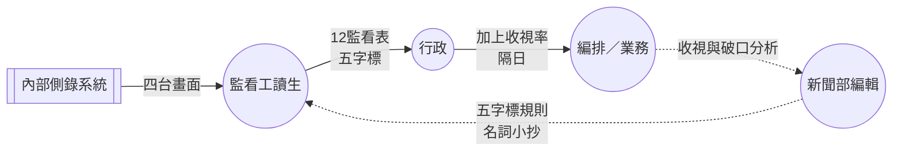
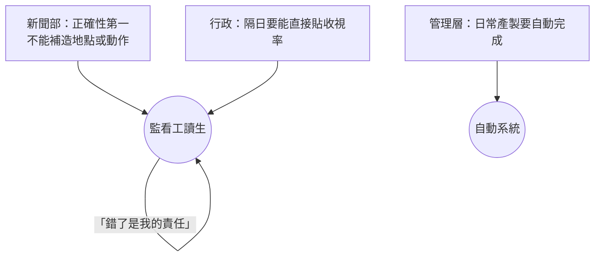
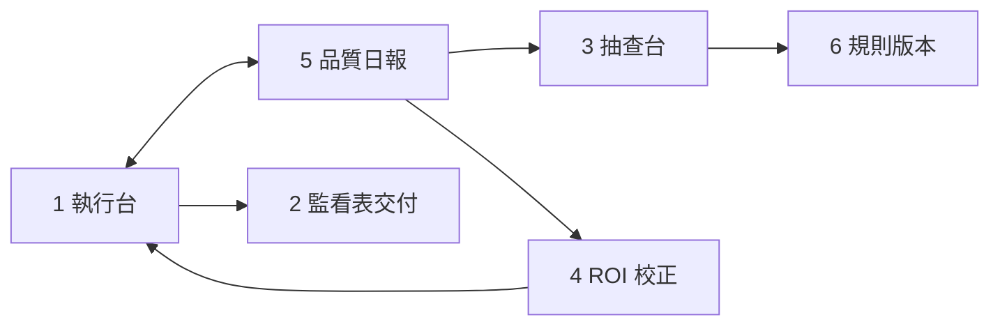

# NewsBar Copilot 需求分析（Contextual Design）

> 版本 v0.2（2026-11-18，需求表加上實作狀態，非功能需求依 ISO/IEC 25010 分類）
> 方法：Contextual Design（Holtzblatt & Beyer, 2017）與課程教材〈work model〉〈Contextual Inquiry〉〈Affinity Diagram〉〈Persona〉
> 流程：工作模型 → 親和圖 → 想望與分鏡 → User Environment Design（UED）→ 需求清單 → 驗證計畫

## 0. 資料基礎與缺口

教材要求的實地訪查（Contextual Inquiry，一對一、1.5–2 小時）**尚未進行**。本版模型以三種二手資料重建，每一筆 breakdown 都標出來源：

| 代號 | 資料 | 內容 |
|---|---|---|
| T | 題目說明〈新聞監看全自動填表〉 | 工作描述、痛點、廣告包框說明、五字標規則、名詞小抄 |
| A | 10/26 填寫範例（12監看分頁） | 實際工件：60 列 × 5 台，101 筆競台標記、12 筆廣告 |
| I | 推論 | 由 T、A 推得，**必須由訪談驗證** |

補救計畫見 [§7 驗證](#7-驗證計畫)：研究者先用 11/06 影片親自模擬監看 30 分鐘並放聲思考，再訪談至少 5 位監看員。

---

## 1. 工作模型（現況）

### 1.1 流程模型（Flow Model）



| ⚡ | Breakdown | 來源 |
|---|---|---|
| F-BD1 | 監看表要到**隔日**才加上收視率，分析延後一天 | T |
| F-BD2 | 工讀生記錯的時間或事件，會**原封不動傳到**收視與破口分析，下游無法察覺 | T |
| F-BD3 | 判斷規則（什麼算換題、廣告怎麼記）靠口頭與範例傳遞，沒有可檢查的標準 | T、I |

### 1.2 作業順序模型（Sequence Model）：午間監看一小時

**觸發**：12:00 午間新聞開播
**主要意圖**：四台每一則新聞都記到正確的分鐘，不漏、不錯

```
活動：監看一台（在四台之間輪流重複）
  意圖：知道這台現在在播什麼
  1 看這台主 bar
  2 bar 變了嗎？
      ├ 沒變 → 換看下一台
      └ 變了 → 3
  3 這是新的一則，還是同一則換副標或換畫面（SOT／Live／假連）？ ⚡ S-BD3
  4 主畫面還在播新聞，還是已經進廣告（包框）？ ⚡ S-BD2
  5 想五字標（社會新聞要有地點、不能補造）       ⚡ S-BD5
  6 看時鐘，找到 Excel 對應分鐘列               ⚡ S-BD6
  7 輸入；同分鐘已有字就用「/」接上             ⚡ S-BD7
  8 換看下一台
```

| ⚡ | Breakdown | 來源 |
|---|---|---|
| S-BD1 | 看 A 台時 B 台換題，回來才發現 → 漏記或晚記一分鐘。範例中 14 個分鐘有 3 台以上同時換題 | T、A |
| S-BD2 | 包框時新聞 bar 和側邊推播還在，容易誤記成新聞 | T（附圖） |
| S-BD3 | 畫面換了不等於換題；題目需要附「名詞小抄」，顯示這是常見困惑 | T |
| S-BD4 | 跑馬燈、快訊、天氣角和主 bar 同時出現，容易抄錯條 | T |
| S-BD5 | 想五字標要兼顧可辨認、忠於報導、有地點，每則都要停下來想 | T、A |
| S-BD6 | 手動對時鐘找列，忙的時候容易填錯列 | I |
| S-BD7 | 同分鐘多則要記得用「/」，範例中有 2 次 | A |
| S-BD8 | 廣告結束回來，要重新判斷是不是同一則；範例中 12 筆廣告後都接新的一則 | A |

### 1.3 工件模型（Artifact Model）：12監看分頁

| 面向 | 觀察 | 來源 |
|---|---|---|
| 結構 | 每分鐘一列（1200–1259）；每台「五字標、A30、M30、A4+」四欄；台別順序三立、TVBS-N、東森、民視、華視 | A |
| 隱含語意 | **空白 = 延續前一個狀態**（新聞延續或廣告持續），不是「沒資料」 | A |
| 記法 | 換題分鐘填標；`/` 並列；`廣告`；`氣象` | A |
| 標的形式 | 多為 5 字，也有 6 字與英文（`Youbike椅太高`、`MUSIC EXPO`） | A |
| 跨台一致 | 同事件在多台用同一個標（`中逼康永歉`、`追打害溺斃`） | A |
| 變通痕跡 | 三立自家欄出現 `廣告 2`、`廣告3`、`30秒廣告.`、`P` 前綴、`1200` 後綴等內部記號 → 記法並不統一 | A |

| ⚡ | Breakdown | 來源 |
|---|---|---|
| A-BD1 | 空白有兩種意思（新聞延續、廣告持續），只能靠往上找最近一個非空白格判斷 | A |
| A-BD2 | 三立欄的廣告記法不一致，代表規則沒有寫死；競台欄必須統一為 `廣告` | A |
| A-BD3 | 表上沒有任何「依據」：看表的人無法知道某格是怎麼判斷的 | A、I |

### 1.4 實體環境模型（Physical Model）

| 元素 | 推論 | 來源 |
|---|---|---|
| 配置 | 一張桌子，四到五個畫面，加一台開 Excel 的電腦 | T、I |
| 視野 | 眼睛只能盯一個畫面，其餘靠餘光 | I |

| ⚡ | Breakdown | 來源 |
|---|---|---|
| P-BD1 | 視野無法同時涵蓋四台 bar，加上要低頭打字，注意力一直被切斷 | I |

### 1.5 文化模型（Cultural Model）



| ⚡ | Breakdown | 來源 |
|---|---|---|
| C-BD1 | 正確性壓力落在權限最低的工讀生身上 | T、I |
| C-BD2 | 管理層要求全自動，新聞部要求正確，兩者張力要靠「可驗證」化解 | T |

---

## 2. 人物誌（Persona）

| 人物 | 角色 | 目標 | 最大痛點 | 對系統的期待 |
|---|---|---|---|---|
| **小安**（21 歲，大學生，排班工讀） | 監看工讀生 | 準時交表、不被說記錯 | 一人看四台必漏 | 不用再盯螢幕；有錯時看得出是誰判的 |
| **美玲**（35 歲） | 行政 | 隔天早上直接貼收視率 | 時間錯位要回頭找人問 | 格式完全不變、準時拿到 |
| **志豪**（40 歲） | 編排／業務 | 看各台同事件收視、廣告破口 | 資料隔日才有、可信度不明 | 早一點拿到、能比較跨台同事件 |
| **維運工程師** | AI 轉型辦公室 | 系統穩定、問題好查 | 電視台改版就壞 | 有告警、能快速重設 bar 位置 |

小安與美玲是**主要人物**：系統先滿足他們。

---

## 3. 親和圖（Affinity Diagram）

從 §1 的 breakdown 由下而上歸納。Green 為大主題，Pink 為議題，Blue 為使用者口吻的瓶頸。

**G1　我一個人顧不了四台**
- P：換題常常同時發生
  - B：「看 A 台的時候 B 台已經換了」← S-BD1、P-BD1

**G2　我分不清這是不是新的一則**
- P：畫面換了不一定換題
  - B：「切到記者連線，我不知道要不要記」← S-BD3
- P：主標副標會輪播
  - B：「bar 字變了，但其實還是同一件事」← S-BD3、I

**G3　廣告來了，bar 卻還在**
- P：包框會騙人
  - B：「左邊在播廣告，下面還是新聞標題」← S-BD2
- P：回來時要重新認
  - B：「廣告完回來，我要再確認是不是同一則」← S-BD8

**G4　畫面上的字太多**
- B：「跑馬燈、快訊、天氣都在跑，我要找對那一條」← S-BD4

**G5　表上的空白要讀對**
- P：空白有兩種意思
  - B：「要往上找才知道現在是新聞還是廣告」← A-BD1
- P：記法要統一
  - B：「三立欄的廣告寫法每次都不一樣」← A-BD2

**G6　我要能相信機器寫的東西**
- P：看不到依據
  - B：「這格是怎麼來的？我沒辦法檢查」← A-BD3
- P：錯了誰負責
  - B：「機器記錯，最後會不會算我的」← C-BD1

**G7　格式一動，後面全部壞掉**
- B：「欄位或順序一變，我貼收視率就會錯位」← F-BD2、美玲

**G8　電視台一改版，系統就要跟上**
- B：「bar 換位置，系統還在讀舊的地方」← I、維運

---

## 4. 想望與分鏡（Vision & Storyboards）

**想望**：監看員不再盯螢幕。系統每小時自動交付監看表；人只看系統排好的「最值得檢查的幾筆」，看得到每格的依據；修正會讓系統下週更準。

### SB1　午間自動交付（主角：美玲）
1. 12:00 內部側錄開始切檔，系統自動排入處理。
2. 13:15 監看表自動出現在共用資料夾，檔名含日期與時段。
3. 美玲打開，欄位與昨天一模一樣，直接貼收視率。

### SB2　十分鐘抽查（主角：小安）
1. 小安打開「抽查台」，看到四台時間軸並列，系統把低信心與 fallback 的格子排在最前面。
2. 點一格：看到該秒的 bar 截圖、前後 10 秒片段、系統判斷依據（例如「版面改變＋黑場 → 廣告」）。
3. 判斷正確就按「對」；錯了就輸入正確寫法並選錯誤類型。
4. 修正存進修正紀錄；**已交付的原始結果保留**，另產生「修正版」。

### SB3　電視台改版（主角：維運工程師）
1. 日報顯示東森 OCR 空白率從 3% 跳到 60%，系統告警。
2. 工程師打開「ROI 校正」，載入東森最新截圖，框出新的 bar 位置，即時看到 OCR 讀出的字。
3. 儲存後重跑當日東森，日報恢復正常。

### SB4　廣告包框（主角：系統）
1. 華視 12:32 主畫面縮成左側框，同時出現 0.5 秒黑場。
2. 系統判定進廣告，12:32 填 `廣告`，之後的 bar 文字一律不採用。
3. 12:35 版面恢復全畫面、主播開口、bar 出現新標題 → 12:35 填新標。

---

## 5. 使用者環境設計（UED）

平台：全部為**內網桌面瀏覽器**；Demo 版以 CLI 加靜態 HTML 報表代替。



| # | Focus Area | Purpose | Functions | Links | Content |
|---|---|---|---|---|---|
| 1 | 執行台 | 讓批次自動跑，並能重跑 | System does：依側錄切檔自動排程<br/>System shows：各台各階段進度、錯誤<br/>User can：重跑某台某時段、從某階段重跑 | → 2、5 | 工作佇列、階段狀態 |
| 2 | 監看表交付 | 交出格式不變的監看表 | System does：只寫四競台五字標欄、驗證其他格未變動<br/>System shows：原始版與修正版兩個檔 | — | xlsx、run_report.csv |
| 3 | 抽查台 | 用最少時間驗證系統判斷 | System shows：四台時間軸並列、依優先序排序的待查格、每格的 bar 截圖／±10 秒片段／依據／信心<br/>User can：標「對」、輸入正確寫法、選錯誤類型、播放片段 | → 6 | 事件、證據、修正紀錄 |
| 4 | ROI 校正 | 設定或更新每台 bar 位置 | User can：載入截圖、框選主 bar／跑馬燈／台徽、儲存<br/>System shows：框內即時 OCR 結果 | → 1（重跑） | 截圖、channels.yaml |
| 5 | 品質日報 | 一眼看出系統是否健康 | System shows：自動填寫率、低信心比例、OCR 空白率、fallback 次數、週 F1；異常告警 | → 3、4 | 每日指標 |
| 6 | 規則版本 | 管理門檻與提示詞的變更 | System shows：版本歷史與各版 F1<br/>System does：週 F1 連兩週 <0.75 自動退版<br/>User can：手動退版 | — | rules.yaml 版本 |

**Issues**：抽查台的錯誤類型清單要和評估的錯誤歸類一致；修正版是否也要交給行政，待業師決定。

---

## 6. 需求清單

優先順序：**M** 必須（Demo 就要有）、**S** 應該（正式上線前）、**C** 可以（之後）。
狀態：✅ 已實作並有自動測試｜◐ 部分完成｜○ 未開始。「追溯」欄指向 §1 的 breakdown 或 §3 的主題。
功能需求回答「系統要**做什麼**」；非功能需求回答「要**做得多好**」，依 ISO/IEC 25010 軟體品質特性分類。

### 6.1 功能需求

| ID | 需求 | 驗收條件 | 追溯 | 優先 | 狀態 |
|---|---|---|---|---|---|
| FR-01 | 四台各自獨立處理，同時換題互不影響 | 四台同一分鐘換題時，四格都正確填寫 | S-BD1、G1 | M | ✅ |
| FR-02 | 只讀主 bar 區域，排除跑馬燈、快訊、天氣角、側欄 | 測試段中沒有任何一格來自非主 bar 文字 | S-BD4、G4 | M | ✅ |
| FR-03 | 能區分「主副標輪播／換畫面」與「新的一則」 | 換題起始分鐘 F1 ≥0.85（±1 分鐘） | S-BD3、G2 | M | ◐ 規則與測試完成；同則判斷為字詞基線、主播鏡頭偵測未做 |
| FR-04 | 先判斷廣告狀態；廣告期間的 bar 文字不採用 | 廣告分鐘 F1 ≥0.90 | S-BD2、G3 | M | ✅ |
| FR-05 | 角落小廣告不判為進廣告 | 測試段中角落廣告誤判為 0 | T | M | ✅ |
| FR-06 | 廣告或中斷結束後的第一個新聞分鐘一律填標 | 測試段中無「廣告後留白接回新聞」的格 | S-BD8、A-BD1、G5 | M | ✅ |
| FR-07 | 同分鐘多則以 `/` 依時間先後並列 | 格式檢查通過 | S-BD7 | M | ✅ |
| FR-08 | 主 bar 在報天氣時填 `氣象` | 格式檢查通過 | T | M | ✅ |
| FR-09 | 競台欄的廣告一律寫 `廣告`，不出現其他變體 | 格式檢查通過 | A-BD2、G5 | M | ✅ |
| FR-10 | 五字標可辨認事件、忠於報導；社會新聞含地點；不補造地點、人名、數字或動作；不把未確認的事寫成定論 | 可用率 ≥85%、捏造 0 筆 | S-BD5、T | M | ✅ 校驗器；LLM 產生器已接（Ollama／Claude），未用真資料評分 |
| FR-11 | 只寫四個競台的五字標欄，其他欄位與格式完全不變 | 非目標儲存格雜湊值寫入前後相同 | F-BD2、G7 | M | ✅ |
| FR-12 | 每一格都記錄依據：來源 bar 原文、秒級時間、判斷訊號、信心、截圖 | evidence.jsonl 每格都有完整欄位 | A-BD3、G6 | M | ✅ |
| FR-13 | 無法判斷時自動 fallback，不停下等人 | 自動填寫率 100% | T、C-BD2 | M | ✅ |
| FR-14 | 訊號中斷時先補抓重跑，仍失敗才填 `訊號中斷` | 模擬中斷測試通過 | A-BD1、I | S | ◐ 偵測與填寫完成；自動補抓需接內部側錄 |
| FR-15 | 抽查台：依優先序列出待查格，顯示截圖、依據，可標對錯、輸入正確寫法 | 3–6 位監看員紙上雛形測試，10 分鐘內完成 20 格 | G6、SB2 | S | ◐ 靜態 HTML 版完成，未做使用者測試 |
| FR-16 | 修正存入修正紀錄；保留原始自動結果，另出修正版 | 兩個檔案同時存在且可比對 | G6、C-BD1 | S | ✅ |
| FR-17 | ROI 校正：框選並即時預覽 OCR 結果；存包框樣板 | 新台別 5 分鐘內完成設定 | G8、SB3 | M | ◐ CLI 版完成，圖形介面未做 |
| FR-18 | 品質日報與告警（填寫率、低信心比、OCR 空白率、fallback 比例） | 模擬改版時當日告警 | G8、C-BD2 | S | ◐ report.json 與告警完成，自動寄送未做 |
| FR-19 | 跨台同事件統一命名 | 同時段同事件跨台同名率 ≥80% | A（跨台一致） | S | ✅ |
| FR-20 | 可從任一階段重跑，中間產物落地 | 刪除某階段輸出後可單獨重建 | SB3 | S | ✅ `--resume`、obs.jsonl |
| FR-21 | 規則與提示詞版本控管，連兩週 F1 <0.75 自動退版 | 退版演練通過 | C-BD2 | C | ◐ 進 git、依據記版本；自動退版未做 |
| FR-22 | 廣告音訊指紋庫，同一支廣告再出現直接命中 | 重播廣告命中率 ≥90% | G3 | C | ✅ 自動累積 |
| FR-23 | 評估工具：標準答案比對、所有指標與錯誤歸類 | 一個指令輸出完整評估報告 | 提案驗證 | M | ✅ `newsbar eval` |
| FR-24 | 接收 MP4／MOV／TS 等常見格式；以時間碼或畫面時鐘校時 | 換算到表上時間誤差 ≤1 秒 | T | M | ◐ 格式與 `--clock` 校時完成；畫面時鐘 OCR 未做 |
| FR-25 | 另存自動原始結果，不覆蓋範本或人工答案 | 範本檔案雜湊值不變 | G7 | M | ✅ |
| FR-26 | 產出處理報告：各台換題數、廣告數、低信心數、fallback 比例、處理時間 | report.json 欄位齊全 | 美玲、維運 | M | ✅ |

### 6.2 非功能需求（ISO/IEC 25010）

**功能適合性（正確性）**

| ID | 需求 | 目標 | 優先 | 狀態 |
|---|---|---|---|---|
| NFR-01 | 換題起始分鐘 F1（±1 分鐘） | ≥0.85 | M | ○ 待 11/06 標註後實測 |
| NFR-02 | 廣告分鐘 F1 | ≥0.90 | M | ○ 同上 |
| NFR-03 | 五字標可用率／捏造率 | ≥85%／0 | M | ○ 同上；捏造由校驗器擋 |
| NFR-04 | 自動填寫率 | 100% | M | ✅ 設計保證 |

**效能效率**

| ID | 需求 | 目標 | 優先 | 狀態 |
|---|---|---|---|---|
| NFR-05 | 每 1 小時四台影片處理時間 | ≤15 分鐘 | M | ◐ OCR 每張約 45 ms，四台循序約 11 分鐘；已支援 `--jobs 4` 平行；ASR 未計 |
| NFR-06 | 成本 | ≤NT$10／台時 | S | ○ |
| NFR-07 | 優先用地端 OCR 與規則，只在換題時呼叫 LLM | 每則最多 2 次呼叫 | M | ✅ |
| NFR-08 | Demo 環境：Mac M4、16GB；中間產物 ≤5GB | 每台每小時截圖約 60 MB | M | ✅ |

**可靠性**

| ID | 需求 | 目標 | 優先 | 狀態 |
|---|---|---|---|---|
| NFR-09 | 單台失敗不影響其他台 | 其他台照常出表，失敗台列入報告 | M | ✅ |
| NFR-10 | 斷點續跑 | 已完成的台別不重跑 | S | ✅ `--resume` |
| NFR-11 | OCR 空白或異常要標記，不靜默出錯 | 空白率 >20%、跑馬燈誤框都告警 | M | ✅ |
| NFR-12 | 無語音或轉錄失敗時降級 | 只靠 OCR 與畫面仍能出表並標低信心 | M | ✅ |
| NFR-13 | 保留原始 OCR、語音、判定紀錄 | ocr_raw、obs、evidence 全部落地 | M | ✅ |

**安全性**

| ID | 需求 | 目標 | 優先 | 狀態 |
|---|---|---|---|---|
| NFR-14 | 資料不出內網：影片只在地端處理；外部 LLM 預設關閉，開啟後只送 bar 文字與 200 字內語音節錄 | 斷網可完整跑完 | M | ✅ |
| NFR-15 | 側錄、逐字稿、監看表限授權人員存取，儲存與傳輸加密 | 依三立資安規範 | S | ○ 部署時由 IT 環境提供 |
| NFR-16 | 操作與修改紀錄可追溯（誰、何時、改什麼） | 修正紀錄含時間與審核者 | S | ✅ 抽查頁必填審核者 |
| NFR-17 | 側錄僅供內部監看與分析，遵守著作權與內部資料政策 | 只保存文字結果，截圖定期清除 | M | ✅ `newsbar cleanup`、watch `--keep-frames-days` |

**可維護性**

| ID | 需求 | 目標 | 優先 | 狀態 |
|---|---|---|---|---|
| NFR-18 | 可解釋：換題與廣告用規則與分數，不用黑箱端到端模型 | 每個判斷能列出觸發訊號 | M | ✅ |
| NFR-19 | 台別 ROI、顏色、包框樣板、門檻、關鍵字都在設定檔 | 新增台別不改程式 | M | ✅ |
| NFR-20 | 模組可獨立測試 | OCR、換題、廣告、五字標、Excel 分開驗證 | M | ✅ 101 個測試 |
| NFR-21 | 錯誤類型統計（漏換題、過度換題、包框誤判…） | 評估與抽查共用同一份分類 | M | ✅ |
| NFR-22 | 後端可替換（OCR、ASR、LLM） | 換後端下游不改 | S | ✅ |

**可攜性與擴充性**

| ID | 需求 | 目標 | 優先 | 狀態 |
|---|---|---|---|---|
| NFR-23 | 從四台擴充到更多頻道 | 新增頻道只加設定檔 | S | ✅ |
| NFR-24 | 從一小時擴充到全天：排程、佇列、平行 | 每小時切檔自動處理 | S | ✅ `newsbar watch`（每小時一組、缺台不擋、重啟不重跑） |
| NFR-25 | 接既有內部系統（檔案匯入、API） | 讀內部側錄切檔 | S | ◐ 檔案匯入完成 |
| NFR-26 | 多種輸出：Excel、CSV、JSON | 同一次執行同時產出 | S | ✅ BI feed 未做 |
| NFR-27 | 歷史資料檢索（日期、台別、議題、人物、地點） | — | C | ○ |

### 6.3 限制

| ID | 限制 | 來源 |
|---|---|---|
| C-01 | 粒度為分鐘，不做秒級紀錄 | T |
| C-02 | 不新增欄位 | T |
| C-03 | 不填收視率、不填三立自家欄 | T |
| C-04 | 10/26 範例只作格式與寫法參考，不是 11/06 的答案 | T |

### 6.4 外部需求草案的取捨

另一份需求草案（FR-01–30、NFR-01–31）已逐條比對；多數併入上表，以下幾條**不採用或修改**：

| 草案條目 | 草案寫法 | 本案處理 | 理由 |
|---|---|---|---|
| FR-14、FR-24 | 無法確認時在表上輸出「待確認」 | 不採用：表上照常填寫，低信心只記在依據與抽查清單 | 題目要求「日常產製仍須自動完成」「不需新增記法」；範例沒有「待確認」，寫進表會讓行政貼收視率時多一種要人工處理的格 |
| FR-21 | 3–6 個中文字 | 改為 4–6 字（英文詞算一字） | 範例全部 4–6 字；3 字難以同時含地點與事件（待業師 Q4） |
| NFR-01、NFR-02 | 換題、廣告「準確率」≥80%／85% | 改為 F1 ≥0.85／0.90 | 換題是稀疏事件，準確率會被大量「沒換題」的分鐘灌高；F1 同時懲罰漏記與多記 |
| NFR-04 | 台別與時間對齊率 100% | 刪除 | 台別欄位固定，必然 100%；時間對齊已含在換題 F1 的 ±1 分鐘 |
| NFR-05 | 自動完成率 ≥90% | 改為 100% | 題目要求不靠人工逐則補填 |
| NFR-07、NFR-08 | 單台 ≤30 分鐘、四台 ≤60 分鐘 | 維持四台 ≤15 分鐘 | 行政要在節目後很快拿到表；實測 OCR 已在範圍內 |
| FR-03 | 時間誤差 ≤1 分鐘 | 改為校時誤差 ≤1 秒 | 1 分鐘誤差會讓整格錯位，等於換題錯誤 |

### 6.5 待決事項

| # | 問題 | 影響 | 問誰 |
|---|---|---|---|
| Q1 | 廣告後接回同一則：重寫原標或另加註記 | FR-06 | 業師 |
| Q2 | `訊號中斷` 這個寫法能不能用 | FR-14 | 業師 |
| Q3 | 自家節目預告算不算廣告 | FR-04 | 業師 |
| Q4 | 五字標是否嚴格 5 字 | FR-10 | 業師 |
| Q5 | 修正版要不要交給行政 | FR-16 | 業師、行政 |
| Q6 | 內部側錄的檔案格式與時間碼 | FR-24、NFR-25 | 三立 IT |
| Q7 | 每日監看時數與班表 | 提案效益 | 業師 |
| Q8 | 12:00 前已在播的那則，`1200` 要不要寫 | spec MAP-6 | 業師 |
| Q9 | 主 bar 只寫事件一半時，可否用語音補足地點 | spec SRC-1、LBL-4 | 業師 |
| Q10 | 換題佐證不足時，寧可多記還是寧可少記 | spec §4.2、FB-1 | 業師 |

---

## 7. 驗證計畫

| 階段 | 做法 | 人數 | 產出 | 依據 |
|---|---|---|---|---|
| 0 自我觀察 | 研究者用 11/06 影片親自模擬監看 30 分鐘，錄影並放聲思考，記下每次卡住的地方 | 1 | 第一手 sequence model 與 breakdown，修正 §1 的推論項 | Contextual Inquiry 原則 |
| 1 脈絡訪查 | 到監看現場一對一觀察與訪談 | ≥5 位監看員，加 1 位行政 | 個人工作模型，更新親和圖 | 教材：最少 5 位 |
| 2 紙上雛形 | 抽查台與日報的紙上雛形，一人操作「模擬電腦」、一人記錄；重演過去真實監看事件 | 每輪 3–6 人，2–3 輪 | 修正 UED 與 FR-15、FR-18 | 教材：每輪 3–6 人 |
| 3 系統評估 | 11/06 測試段跑 `newsbar eval` | 2 位標註者 | §6 各驗收條件的實測值 | 提案 2.3 |

每輪驗證後回頭更新本文件版本號，並在需求表標註「已驗證／已修改」。
