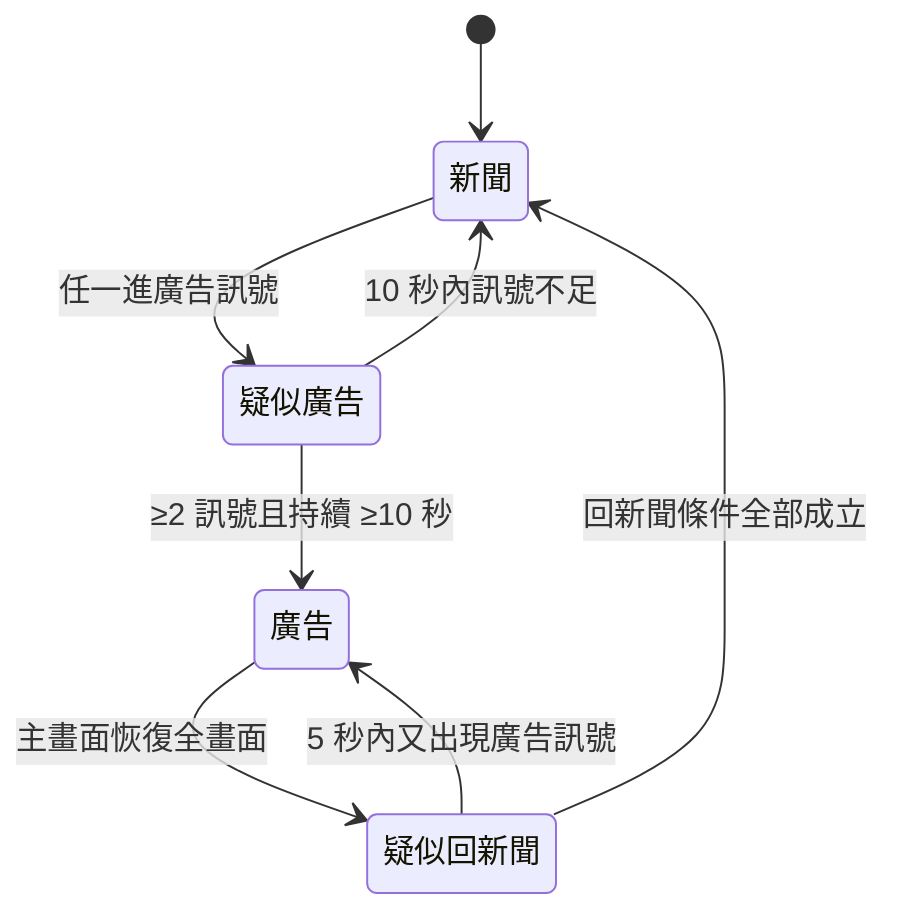

# NewsBar Copilot 功能規格（Spec）

> 版本 v0.1（2026-11-18）
> 依據：題目說明〈00_題目與交件說明_新聞監看全自動填表〉（以下稱「題目」）、10/26 填寫範例（以下稱「範例」）
> 上游：[requirements.md](requirements.md)（需求 ID）｜下游：[architecture.md](architecture.md)（模組實作）
> 本文件只寫「系統必須怎麼表現」，不寫怎麼實作。每條規則都有編號，測試案例以編號對應。

---

## 1. 痛點分析

### 1.1 題目列出的三個痛點，拆到根因

| 痛點（題目原文） | 實際發生的事 | 根因 | 系統要解決的事 |
|---|---|---|---|
| **P1 長時間同時看四台**：持續讀 bar、判斷換題、整理五字標，再對應時間欄輸入 | 一個人每小時要對四台做約 100 次「讀 → 判斷 → 命名 → 找列 → 輸入」（範例：四台 101 筆） | 五個步驟全靠人，而且四台共用同一雙眼睛 | 五個步驟全部自動化，四台各自獨立處理（§4、§6、§7） |
| **P2 多台同時換題**：多台同時換題，或包框、跑馬和新聞標題混淆，事件與時間對不上 | ① 看 A 台時 B 台換題，晚記或漏記；② 包框時 bar 還在，誤記成新聞；③ 抄到跑馬燈或快訊 | ① 注意力只能在一台；② 「bar 還在」被當成「新聞還在」；③ 畫面上有多條文字，沒有固定規則指定讀哪條 | ① 每台獨立判斷，時間以秒記錄後再轉分鐘（§7）；② 先判廣告狀態，再談換題（§5）；③ 只讀主 bar 區域（§3） |
| **P3 後續分析要能用**：行政隔日填收視率；收視率與廣告破口分析需要台別、時間、事件對齊 | 錯一格，下游的分鐘收視就對到錯的事件，而且沒人發現 | 表上沒有依據可以回查；格式一變，行政貼收視率就錯位 | 格式完全不動（§8）；每格附依據（§9）；廣告記法固定（§2） |

### 1.2 題目其他段落隱含的痛點

| 痛點 | 題目依據 | 根因 | 對應規格 |
|---|---|---|---|
| **P4 畫面換了不一定換題** | 「同一則新聞可能先由主播介紹，再接記者報導或連線。畫面換了，不一定就是另一則新聞。」 | 一則新聞由主播稿頭、SOT、Live、假連、說新聞多段組成，畫面與 bar 都會變 | §4 換題判定 |
| **P5 LIVE 字樣會騙人** | 「也不能只看 LIVE 字樣，就判斷是否為預錄。」 | 假連看起來就是 Live | §4.3：LIVE 字樣不作為任何判斷依據 |
| **P6 小廣告不等於進廣告** | 「小廣告出現在旁邊，不等於主新聞停播」 | 角落廣告與包框都會出現廣告畫面 | §5.2：只看主畫面 |
| **P7 回新聞後沿用殘留文字** | 「回新聞後如何恢復五字標，避免沿用包框殘留的文字」 | 包框時 bar 文字凍結，回來後若沒變就會被當成「同一則」 | §5.4 |
| **P8 無法判斷時不能停** | 「遇到無法判斷的片段……不靠人工逐則補填才能繼續」 | 任何模組都可能失效 | §10 fallback |
| **P9 五字標不能捏造** | 「不能補造地點或動作，或把未確認的事寫成定論」 | 生成式模型會補細節 | §6 |
| **P10 天氣有兩種** | 「角落天氣不當成本則新聞。如果節目正在報天氣新聞，仍要記錄。」 | 天氣角落常駐，天氣新聞偶發 | §3.2、§6.5 |

### 1.3 核心洞察

> 表面現象是「一個工讀生看不過來四台」；實際根因是「**換題**」與「**廣告**」這兩個判斷沒有可以被機器讀取的結構化訊號，只能靠人眼即時推論。
> 所以系統的核心不是 OCR，而是兩個判斷器：**廣告狀態機**（§5）與**換題判定**（§4）。OCR 與 LLM 只是它們的輸入與輸出。

---

## 2. 名詞與輸出格式

### 2.1 名詞

| 名詞 | 定義 |
|---|---|
| 主 bar | 畫面下方的主新聞標題列（題目附圖：正常時為藍底白色大字） |
| 一則新聞（story） | 同一個新聞事件從主播稿頭開始，到下一則的主播稿頭（或進廣告）之前的連續播出；可包含 SOT、Live、假連、說新聞 |
| 狀態 | 每台每一秒必屬於下列之一：`新聞(story_id)`、`廣告`、`氣象`、`中斷` |
| 狀態改變 | 狀態或 story_id 改變的那一秒 |
| 分鐘格 | 「12監看」中某台五字標欄的一格，對應一個 HHMM |

### 2.2 分鐘格的文法

```
格值     := 空白 | 項目 ( "/" 項目 )*
項目     := 五字標 | "廣告" | "氣象" | "訊號中斷"
五字標   := 4–6 個字元，不含 "/"、不含前後空白，且不等於任何狀態字
```

| 編號 | 規則 | 來源 |
|---|---|---|
| OUT-1 | **空白 = 前一個非空白格的狀態延續中**；空白不代表「沒資料」 | 範例 |
| OUT-2 | 某分鐘內發生狀態改變，就在該分鐘寫入新狀態的項目 | 範例 |
| OUT-3 | 同一分鐘有多次狀態改變，依發生先後以 `/` 串接 | 範例 `持刀警開槍/台股二補跌` |
| OUT-4 | 廣告一律寫 `廣告`，不寫 `廣告 2`、`30秒廣告` 等變體 | 範例競台欄；三立欄的變體不採用 |
| OUT-5 | 天氣新聞寫 `氣象` | 範例 `氣象` |
| OUT-6 | 從廣告或中斷回到新聞，回來的那一分鐘**一定寫五字標**，即使與廣告前是同一則 | OUT-1 推論：留白會被讀成「還在廣告」 |
| OUT-7 | `訊號中斷` 只在補抓重跑仍失敗時使用 | §10【待業師確認 Q2】 |

---

## 3. 讀哪一條字（P2-③、P10）

### 3.1 區域

每台在設定檔定義以下區域（相對座標 0–1，與解析度無關）：

| 區域 | 用途 |
|---|---|
| `main_bar` | **唯一**的五字標文字來源 |
| `ticker` | 最下方跑馬燈，只用來排除 |
| `flash` | 底部快訊，只用來排除 |
| `weather_corner` | 角落天氣，只用來排除 |
| `logo` | 台徽，用於廣告判斷 |
| `main_video` | 主畫面，用於廣告判斷 |

### 3.2 規則

| 編號 | 規則 |
|---|---|
| TXT-1 | 五字標與換題判斷只使用 `main_bar` 的文字 |
| TXT-2 | `ticker`、`flash`、`weather_corner` 的文字永遠不寫進表 |
| TXT-3 | `main_bar` 內的文字若逐秒水平位移，判定為設定錯誤（讀到跑馬燈），該台該段停用 OCR 訊號並告警 |
| TXT-4 | 同一畫面連續 5 秒內的 OCR 讀數取多數決；信心 < 0.6 的讀數丟棄 |
| TXT-5 | 當 `main_bar` 內容是天氣（例：「各地天氣」「颱風動態」），依 §6.5 寫 `氣象`；角落天氣不觸發此規則 |

---

## 4. 換題判定（P1、P2-①、P4、P5）

### 4.1 什麼不算換題

以下情況**維持同一則**（留白）：

| 編號 | 情況 | 題目依據 |
|---|---|---|
| SAME-1 | 主播稿頭轉 SOT、Live、假連或說新聞 | 名詞小抄 |
| SAME-2 | 鏡頭切換、畫面從棚內轉現場 | 「畫面換了，不一定就是另一則新聞」 |
| SAME-3 | 主 bar 在同一事件的主標與副標之間輪播 | 推論：新聞台常見 |
| SAME-4 | 主 bar 文字變了，但新舊文字指同一事件（人名、地名重疊，或語意相似度 ≥0.75） | 推論 |
| SAME-5 | 出現或消失 LIVE 字樣 | 「不能只看 LIVE 字樣」 |
| SAME-6 | 有語音時，新標題沒有任何 NEW-2 佐證（語音主題未變、無名條、無主播鏡頭） | 11/06 實測：TVBS 同一則輪播 2–5 個不同標題 |
| SAME-7 | 受訪字幕、記者名條（持續 ≤6 秒） | 11/06 實測：字幕與名條和主標題共用同一位置 |

### 4.2 什麼算換題

**同時**滿足以下兩項才判定換題：

| 編號 | 條件 |
|---|---|
| NEW-1 | 主 bar 出現新文字，且不符合 SAME-3、SAME-4 |
| NEW-2 | 下列佐證至少一項成立：<br/>(a) 候選點前後 20 秒內語音主題明顯改變<br/>(b) 候選點前後 5 秒內畫面切回主播台<br/>(c) 候選點前後 5 秒內出現新的主播稿頭語音<br/>(d) 候選點前 25 秒內剛出現過記者名條（SOT 結尾的「記者 A、攝影 B」），名條＝純人名、2–12 字、無虛字 |

只有 NEW-1、沒有 NEW-2 時：**沒有語音**則信心降為「低」、仍判定換題並列入抽查（漏記比多記更難發現）；**有語音**則依 SAME-6 視為同一則。11/06 TVBS 前 13 分鐘實測（研究者目測 8 個換題點）：只用 OCR 分鐘級 F1 ≈0.80，加語音 ≈0.94。

### 4.3 禁用訊號

| 編號 | 規則 |
|---|---|
| BAN-1 | LIVE、直播、連線等字樣不得作為換題或同則的依據 |
| BAN-2 | 單純的鏡頭切換不得單獨觸發換題 |

### 4.4 換題時間

| 編號 | 規則 |
|---|---|
| TIME-1 | 換題時間 = 新主 bar 文字**第一次穩定出現**（連續 ≥7 秒相同讀數）的那一秒。11/06 實測：標題持續 7–45 秒，字幕與名條 1–6 秒 |
| TIME-2 | 若主播稿頭語音比 bar 早出現，仍以 bar 時間為準（工讀生看的是 bar） |

---

## 5. 廣告與包框（P2-②、P6、P7）

### 5.1 狀態機



### 5.2 進廣告訊號

| 代號 | 訊號 | 說明 |
|---|---|---|
| AD-a | 主畫面版面改變 | 包框時主畫面縮成側框（題目附圖：左側大畫面播廣告、右側新聞推播） |
| AD-b | 主 bar 底色改變 | 題目附圖：正常為藍底，包框時為黃色 bar；顏色依台別設定 |
| AD-c | 台徽消失或位置改變 | — |
| AD-d | 黑場或靜音破口 0.2–1 秒 | 廣告切入常見 |
| AD-e | 語音出現品牌、價格、促銷詞，且沒有主播或記者語音 | — |
| AD-f | 音訊指紋命中已知廣告 | 同一支廣告會在多台、多天重播 |

| 編號 | 規則 |
|---|---|
| AD-1 | 進廣告 = 任兩項訊號同時成立且持續 ≥10 秒；廣告起點為第一個訊號出現的那一秒 |
| AD-2 | **只看主畫面**：角落小廣告不改變 `main_video` 的版面，不構成 AD-a，不得單獨觸發進廣告 |
| AD-3 | 「看得到新聞文字」不能否決進廣告：主 bar 或側邊推播仍在時，只要 AD-1 成立就是廣告 |
| AD-4 | 電視台自家節目預告與宣傳片比照廣告【待業師確認 Q3】 |

### 5.3 廣告期間

| 編號 | 規則 |
|---|---|
| AD-5 | 廣告期間主 bar 與側邊推播的文字**全部不採用**，不得成為換題候選，也不得作為五字標來源 |
| AD-6 | 記錄進廣告前最後一個主 bar 讀數，作為「殘留文字」，供 §5.4 比對 |

### 5.4 回到新聞

| 編號 | 規則 |
|---|---|
| AD-7 | 回新聞 = 以下**全部**成立且維持 ≥5 秒：<br/>(1) 主畫面恢復全畫面版面；(2) 主 bar 底色恢復；(3) 出現主播或記者語音；(4) 主 bar 出現**與殘留文字不同**的讀數，或殘留文字所屬的同一則被語音確認仍在播 |
| AD-8 | 回新聞的時間點寫五字標（OUT-6）。若主 bar 仍是殘留文字且語音確認是同一則，五字標沿用廣告前那則；否則依 §6 產生新標【寫法待業師確認 Q1】 |
| AD-9 | 若主畫面恢復但 (3)(4) 遲遲不成立超過 60 秒，判定為「回新聞」，並以 §10 FB-3 處理五字標 |

---

## 6. 五字標（P9、P10）

### 6.1 必要條件

| 編號 | 規則 | 題目依據 |
|---|---|---|
| LBL-1 | 能讓看表的人認出是哪則新聞 | 「讓看表的人認得大概是哪則新聞」 |
| LBL-2 | 忠於報導；不得補造地點或動作 | 原文 |
| LBL-3 | 不得把未確認的事寫成定論：來源有「疑」「傳」「恐」「涉」等語氣時，標不能刪去這層語氣，或改用不涉及定論的角度 | 原文 |
| LBL-4 | 社會事件**必須**含地點，且地點必須出現在來源文字中；來源沒有地點時，改用 LBL-6 的角度並列入抽查 | 「社會事件一定要有地點」 |
| LBL-5 | 長度 4–6 個字元；英文專有名詞以原樣保留（範例：`MUSIC EXPO`、`Youbike椅太高`）【嚴格 5 字與否待業師確認 Q4】 |  範例 |
| LBL-6 | 非社會新聞可選人物、事件或結果作為切入角度 | 「其他新聞可選擇不同切入角度」 |

### 6.2 來源限制

| 編號 | 規則 |
|---|---|
| SRC-1 | 五字標只能用該則新聞期間的主 bar 文字與語音轉錄作為來源 |
| SRC-2 | 五字標中的每個名詞（人名、地名、機構、物件）都必須能在來源中找到原字或標準簡稱（例：新北土城 → 土城；張俊傑 → 俊傑） |
| SRC-3 | 動詞或結果必須在來源中有對應（例：「輾亡」對應「遭貨車輾亡」） |

### 6.3 校驗與重試

```
產生 → 校驗(LBL-2~5, SRC-2, SRC-3)
  ├ 通過 → 採用
  └ 不通過 → 重新產生 1 次 → 校驗
                 ├ 通過 → 採用
                 └ 不通過 → 規則擷取：主 bar 文字中「地點 ＋ 核心動詞或結果」→ 截到 6 字內 → 採用，標記 fallback
```

### 6.4 範例驗收

| 主 bar 原文 | 合格 | 不合格（原因） |
|---|---|---|
| 新北土城一七旬老翁 轉彎不慎遭貨車輾亡 | `土城翁輾亡` | `板橋翁輾亡`（地點錯）、`老翁被撞`（社會事件缺地點）、`貨車撞死翁`（缺地點） |
| 張俊傑「9分鐘偷渡術」曝 高金素梅共諜案起訴求刑14年 | `俊傑偷渡中`、`高金遭起訴` | `高金被判刑`（起訴求刑≠判刑，把未確認寫成定論） |

### 6.5 跨台一致

| 編號 | 規則 |
|---|---|
| X-1 | 同一時段（±15 分鐘）內，若他台已有同一事件的標（人名、地名重疊 ≥1 且語意相似度 ≥0.8），沿用該標 |
| X-2 | X-1 的沿用標仍須通過 SRC-2（本台來源裡也要有那些字） |

---

## 7. 台別與時間對應（P1、P2-①、P3）

| 編號 | 規則 |
|---|---|
| MAP-1 | 四台各自獨立處理；任一台的判斷不得影響他台的時間或狀態（X-1 只影響命名） |
| MAP-2 | 時間基準：影片時間碼；沒有時間碼時，OCR 畫面上的時鐘校正，誤差 ≤1 秒 |
| MAP-3 | 狀態改變的秒數無條件捨去到所屬分鐘：12:03:59 → `1203` |
| MAP-4 | 同一分鐘多次狀態改變依 OUT-3 串接 |
| MAP-5 | 連續兩次相同狀態（同一 story_id、或都是廣告）視為延續，不重複寫入 |
| MAP-6 | 12:00:00 之前已在進行的狀態，寫在 `1200`【待業師確認 Q8】 |
| MAP-7 | 13:00:00 之後的狀態改變不寫入 |

---

## 8. 寫入 Excel（P3）

| 編號 | 規則 |
|---|---|
| XLS-1 | 只寫「12監看」分頁中 TVBS-N、東森、民視、華視四欄的五字標格 |
| XLS-2 | 三立欄、收視率欄（A30、M30、A4+）、表頭、日期、所有格式，寫入前後必須完全相同（逐格比對值與格式） |
| XLS-3 | 依表頭文字定位「時間列」與「台別欄」，不得寫死儲存格座標 |
| XLS-4 | 目標格在寫入前若已有內容，停止並回報錯誤，不覆寫 |
| XLS-5 | 不新增欄位、分頁或秒級紀錄 |
| XLS-6 | 檔名：`12監看_YYYYMMDD.xlsx`；另產生同名 `.evidence.jsonl` 與 `.report.csv` |

---

## 9. 依據與抽查（P3、P8）

### 9.1 每格的依據

每個寫入的格子都必須有一筆依據紀錄：

| 欄位 | 內容 |
|---|---|
| `channel`、`minute`、`value` | 寫入的位置與值 |
| `items[]` | 每個項目的：狀態、秒級起點、主 bar 原文、語音片段、截圖路徑 |
| `signals` | 觸發的訊號代號（例：`NEW-1, NEW-2a` 或 `AD-a, AD-d`） |
| `confidence` | 高／中／低 |
| `fallback` | 若走了 §10 的 fallback，記其編號 |
| `rules_version` | 規則版本 |

### 9.2 抽查優先序

1. 走過 fallback 的格（§10）
2. 信心「低」的格
3. 廣告的起點與回新聞點
4. 其餘隨機抽樣

抽查結果寫入修正紀錄，**不改動已交付的原始結果**；另產生修正版供比對。

---

## 10. 無法判斷時（P8）

| 編號 | 情況 | 系統動作 | 表上結果 |
|---|---|---|---|
| FB-1 | 換題佐證不足（只有 NEW-1） | 判定換題，信心低 | 寫新標 |
| FB-2 | 主 bar 文字有變但無法判斷是不是同一則 | 依 FB-1 處理 | 寫新標 |
| FB-3 | OCR 讀不到主 bar | 以語音轉錄為來源產生五字標，仍須通過 §6 校驗 | 寫標 |
| FB-4 | 五字標兩次校驗失敗 | §6.3 規則擷取 | 寫標 |
| FB-5 | 廣告訊號互相矛盾 | 以多數決；平手時判「新聞」 | 依結果 |
| FB-6 | 訊號中斷（黑畫面 >30 秒或無訊號） | 從內部側錄補抓重跑；仍失敗才寫 | `訊號中斷` |

| 編號 | 規則 |
|---|---|
| FB-R1 | 任何情況都不得停下等待人工輸入 |
| FB-R2 | 每次 fallback 都要寫進依據紀錄，並進入抽查優先清單 |
| FB-R3 | 一小時內 fallback 超過 20% 的台，日報標紅告警 |

---

## 11. 驗收測試案例

格式：**前提 → 輸入 → 預期**。全部應有自動化測試；以合成事件或合成畫面即可驗證，不需要真實影片。

| # | 對應規則 | 前提 | 輸入 | 預期 |
|---|---|---|---|---|
| T01 | OUT-1, MAP-5 | TVBS 12:00:10 開始 A 則 | A 則持續到 12:05:30 | `1200`=A，`1201`–`1205` 空白 |
| T02 | OUT-3, MAP-4 | 同一分鐘兩次換題 | 12:28:05 換 B、12:28:40 換 C | `1228`=`B/C` |
| T03 | OUT-6, AD-8 | 廣告前是 A 則 | 12:32 進廣告、12:35 回來仍是 A 則 | `1232`=`廣告`，`1235`=A |
| T04 | MAP-5 | 廣告中再偵測到一次廣告 | 12:40:00 與 12:41:30 各一個廣告事件 | 只有 `1240`=`廣告` |
| T05 | AD-2 | 角落出現小廣告 | 主畫面版面不變、只有角落廣告 | 不進廣告 |
| T06 | AD-3, AD-5 | 包框，bar 文字仍是 A 則 | AD-a＋AD-b 持續 15 秒 | 判廣告；包框期間 bar 文字不產生任何換題 |
| T07 | AD-7 | 包框結束後 bar 仍為殘留文字、無主播語音 | 版面恢復 | 不立即回新聞；60 秒後依 AD-9 處理 |
| T08 | SAME-1, SAME-5 | A 則從主播稿頭轉入 Live，畫面出現 LIVE 字樣 | 鏡頭切換＋LIVE 字樣 | 不換題 |
| T09 | SAME-3 | bar 在 A 則主標與副標之間輪播 | 每 8 秒交替 | 不換題 |
| T10 | TXT-2 | 跑馬燈出現新文字 | ticker 區域變化 | 不換題、不寫入 |
| T11 | TXT-5, OUT-5 | 主 bar 為天氣新聞 | 「各地天氣」標題 | 寫 `氣象` |
| T12 | TXT-5 | 只有角落天氣 | weather_corner 有字 | 不寫 `氣象` |
| T13 | LBL-4, SRC-2 | 社會新聞，來源有「新北土城」 | 生成「板橋翁輾亡」 | 校驗失敗並重試 |
| T14 | LBL-3 | 來源為「起訴求刑」 | 生成「高金被判刑」 | 校驗失敗 |
| T15 | §6.3 | 兩次生成都失敗 | — | 規則擷取並標 fallback=FB-4 |
| T16 | MAP-3 | 換題在 12:03:59.8 | — | 寫在 `1203` |
| T17 | MAP-6 | A 則 11:58 開始 | — | `1200`=A |
| T18 | MAP-7 | 13:00:05 換題 | — | 不寫入 |
| T19 | XLS-2 | 範本已有三立欄與收視率 | 寫入四台 | 非目標格的值與格式完全相同 |
| T20 | XLS-4 | 目標格已有字 | 寫入 | 報錯、不覆寫 |
| T21 | XLS-3 | 範本多一列表頭 | 寫入 | 仍寫到正確的時間列 |
| T22 | MAP-1 | 四台同一分鐘換題 | 四台各自事件 | 四格都正確 |
| T23 | FB-R1 | OCR 全部失效 | 一小時 | 仍產出完整表、每格有依據、自動填寫率 100% |
| T24 | 範例回測 | 範例 TVBS-N 欄 | 由該欄還原的事件序列 | 重新產生的欄與範例逐格相同 |

---

## 12. 參數

所有門檻集中在 `config/rules.yaml`，以 12:00–12:20 調參，12:20–13:00 只測試。

| 參數 | 預設 | 規則 |
|---|---|---|
| OCR 最低信心 | 0.6 | TXT-4 |
| OCR 投票窗 | 5 秒 | TXT-4 |
| bar 穩定秒數 | 7 秒 | TIME-1 |
| 名條最長秒數／有效窗 | 5 秒／25 秒 | NEW-2d |
| 同則語意相似度 | 0.75 | SAME-4 |
| 語音主題比對窗 | ±20 秒 | NEW-2a |
| 主播台／稿頭比對窗 | ±5 秒 | NEW-2b、NEW-2c |
| 進廣告最少訊號數 | 2 | AD-1 |
| 進廣告最短持續 | 10 秒 | AD-1 |
| 回新聞確認時間 | 5 秒 | AD-7 |
| 回新聞逾時 | 60 秒 | AD-9 |
| 中斷判定 | 黑畫面 >30 秒 | FB-6 |
| 跨台沿用窗 | ±15 分鐘 | X-1 |
| 跨台語意相似度 | 0.8 | X-1 |
| fallback 告警比例 | 20% | FB-R3 |

---

## 13. 待業師確認

| # | 問題 | 影響規則 | 系統預設 |
|---|---|---|---|
| Q1 | 廣告後接回同一則：重寫原標或另加註記 | AD-8 | 重寫原標 |
| Q2 | `訊號中斷` 這個寫法能不能用 | OUT-7、FB-6 | 使用 |
| Q3 | 自家節目預告算不算廣告 | AD-4 | 算廣告 |
| Q4 | 五字標是否嚴格 5 字 | LBL-5 | 4–6 字 |
| Q5 | 修正版要不要交給行政 | §9.2 | 不交，只內部比對 |
| Q8 | 12:00 前已在播的那則，`1200` 要不要寫 | MAP-6 | 寫 |
| Q9 | 主 bar 只寫了事件一半（例如只有人名）時，可否用語音補足地點 | SRC-1、LBL-4 | 可以，語音屬來源 |
| Q10 | 換題佐證不足時，寧可多記還是寧可少記 | §4.2、FB-1 | 寧可多記 |
